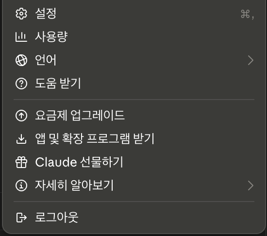
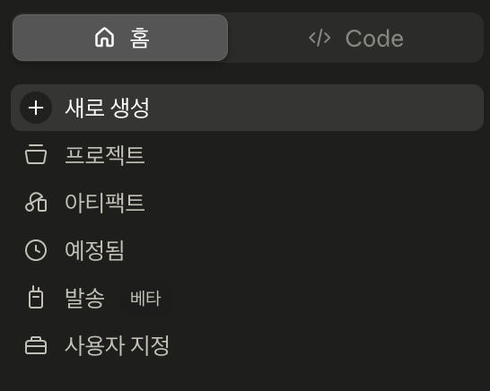
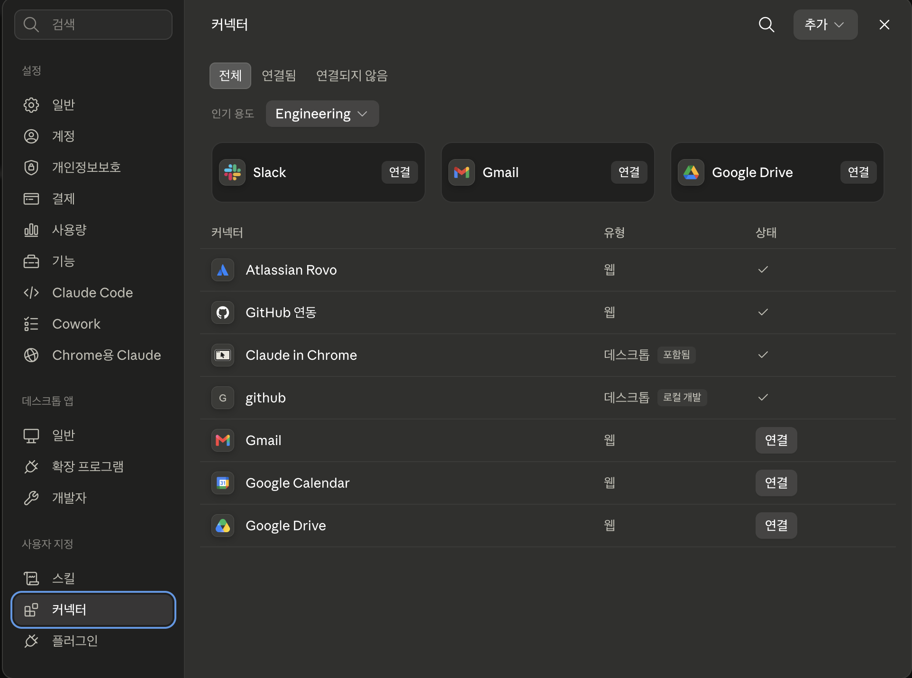
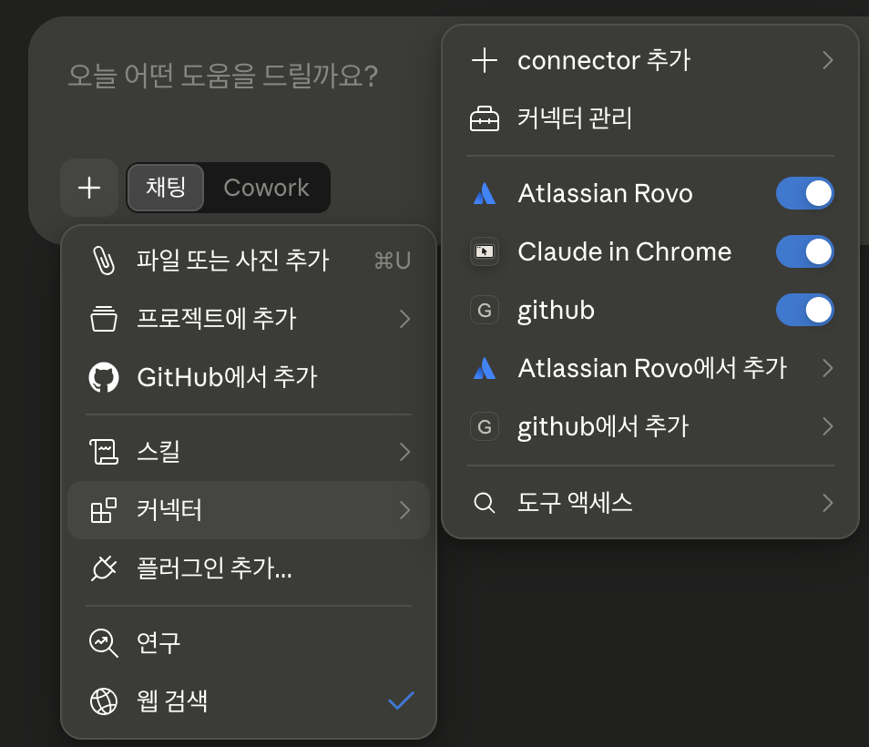

# Built-in Connectors: Atlassian and GitHub

> How to connect services you already use to AI **just by signing in and approving on screen**, without touching any settings files.

Connectors are a list of connections Claude has prepared in advance. Pick a service from the list, sign in as usual, review which data it will access, and approve. Then the connection is done. You only pick something ready-made and connect it, so it is the easiest way in for non-developers.

Using **Atlassian** (Jira and Confluence) and **GitHub** as examples, this page covers how to connect and disconnect, and what you must check on the approval screen. For work data, Atlassian usually comes first. GitHub comes later because [whether to connect it at all depends on your situation](#github).

---

## You don't build connectors { #what-is-connector }

In Part 1, [Key Terms: The harness is mostly "the things you set up"](../basics.md#model-harness), we split where a harness comes from into three sources. Under **"What you only choose and connect"** was "Connect external services." Connectors are exactly that, in practice.

The service provider and Anthropic have already built the connection itself. Your part is **to choose what to use and decide what to allow**.

So what you need to use connectors is **judgment**, not technical skill. You only need to decide three things: which service to connect, how much to allow, and how to check the results.

---

## How to connect { #how-to-connect }

There are two ways to reach the connector screen, and both open the same screen.

!!! note "① Your name (bottom left) → Settings → Connectors"
    

!!! note "② Home tab (top left) → Customize → Connectors"
    

You land on the screen below: the **Customize → Connectors** menu near the bottom of the left list. You use the same screen to check services you have already connected.

Services you have already connected show **a check mark in the status column**; services not yet connected show a **Connect button**. The **Add** button at the top right, for registering things not in the list, belongs to [MCP servers](mcp-servers.md), so we don't use it here.

*Screenshots are from Claude Desktop and may look slightly different after app updates.*

!!! tip "In the middle of a chat, you can open it here too"
    Click the **`+` button** at the bottom left of the chat box (or type `/`) and hover over **Connectors**. It opens right in the chat, without going out to Settings.

    

    - **Add connector**: a menu for registering something not in the list yourself. We don't use it here; it is covered in [MCP servers](mcp-servers.md).
    - **Manage connectors**: opens the same connector screen you saw above.
    - **Per-service toggles**: turn on only what you will use in this chat (→ step 5 below).
    - **Tool access**: decides when the connectors you've turned on get loaded (→ "Turn on only what you need" just below).

Once you're on this screen, the rest is the same for every service.

1. **Choose**: click the service you want and read its description and what it can do.
2. **Start connecting**: click the **Connect** (or **Install**) button.
3. **Sign in**: sign in with your usual account for that service. No need to create a new one.
4. **Approve permissions**: the screen shows which data it will access. **Stop here and read** (→ [just below](#approval-screen)).
5. **Turn it on in the chat**: connecting does not mean it is always used. Turn on that service's **toggle** under the `+` button → **Connectors**, and it will be used in that chat.

**Turn on only what you need.** In **Tool access** in the same menu, you can choose one of three options for when the connectors you've turned on get loaded.

- **Auto** (default): Claude loads only what it needs for the task at hand. In most cases, leave it as is.
- **Always available**: loads all turned-on connectors when the chat starts. Handy if you always use a few.
- **On demand**: loads them only when something needs to be looked up. Use this when you have many connections and chats get heavy.

The more connectors you turn on, the more room AI has to search in the wrong places. How to choose is explained in [Managing Claude's tool access](https://support.claude.com/en/articles/13730515).

Official guide: [Use connectors to extend Claude's capabilities](https://support.claude.com/en/articles/11176164). If the screens change, this guide is the reference.

---

## What to check on the approval screen { #approval-screen }

This is where the biggest decision in the connection process happens. Check just three things.

| What to check | Why it matters | What to do |
|---|---|---|
| **Read only, or write too?** | Read means fetching data; write means leaving traces in that service (creating documents, commenting on issues, etc.) | If you can leave write out, leave it out and approve |
| **How far does it reach?** | All repositories or only some; which projects or spaces | If you can narrow it, pick only what you need |
| **Whose permissions does it run with?** | A connector uses **your account's permissions as they are** | AI cannot see data you cannot see. On the other hand, **everything you can see is the widest range that can be opened to AI** |

What the approval screen lets you choose **differs by service.** Some let you pick repositories or spaces to approve; others bundle read and write into a single approval. If the screen gives you no options, there is no way to narrow it there, so narrow it in these two ways instead.

- **Narrow it when turning it on in a chat**: toggle on only the connectors you need for the current task. Connections you don't turn on are not used in that chat.
- **Narrow it when asked**: when AI asks you to approve a write action, decline anything you don't need right now.

!!! warning "'Your own permissions, as they are' is both reassuring and a warning"
    It is reassuring that no new permissions are created. But if your account can access most of your company's data, **the range that can be opened to the connected AI is just as wide.** Ask yourself once, "Are my permissions on the broad side?" If they are, narrow things by one step, whether in what you approve or in what you turn on in chats.

    Rules for connections that carry company data are in [Security and Privacy Guide: External connections](../security-guide.md#external-connection).

---

## Atlassian: Jira and Confluence { #atlassian }

Confluence handles documents such as meeting notes, policies, and planning documents; Jira handles work requests and progress. If you use either one, this is where non-developers copy and paste most often, so it is the connector where you feel the benefit fastest.

!!! example "Confluence: read and organize"
    - "Find last week's team meeting notes and list only the decisions"
    - "Read the vacation policy and rewrite it as questions new hires often ask"
    - "Find the pages in this space that mention 'business trip' and give me a list"

!!! example "Jira: check status"
    - "From the issues assigned to me, list only the ones due this week"
    - "Group the items not yet done in this sprint and write a draft for a status report"
    - "Summarize the discussion on this issue so far in three lines"

The Atlassian connector supports **both read and write**. That means it can even create new Confluence pages and comment on Jira issues. It is convenient, but it is also easy to forget that the results stay as they are in a space the whole team sees.

**What AI writes is published to your team under your name.** Because you connected with your account, documents and comments AI creates are posted **as written by you**. Let it draft, but always include **a step where you read and fix it before it goes up**. This is why [meta-principle ③, the duty to review and understand AI output](../index.md#meta-principles), matters even more after you connect.

We recommend this order: for the first few times, ask only for reading, and when it asks you to approve a write action, decline until the results prove reliable.

Here too, access follows **the Jira and Confluence permissions you already have**. Spaces you cannot see are invisible to AI as well.

---

## GitHub: where source code is managed { #github }

GitHub is basically **a tool for storing source code and managing its change history**. Documents and issues from the development process pile up there too, but that is not what the tool is for. So unlike Atlassian above, whether a non-developer should connect it **depends on which situation you are in.**

!!! example "GitHub: developing applications"
    - "Summarize what this issue asks for and tell me which files to look at first"
    - "Write code that resolves this issue"
    - "Do a code review of this PR"

- **If you only need to read, you don't need to connect.** Public repositories can be viewed without an account, so to read a README or issues, just give the address and ask. This training's [lab materials](../labs.md) are also in a public repository.
- **If you have separate work tools, we recommend not connecting it.** If your company has tools for managing issues and work (Jira, Confluence, etc.), non-developers usually have no reason to connect GitHub as well. Content that both sides need to see is better managed in those tools, for everyone.
- **GitHub Enterprise is different.** With the version your company runs, even repositories opened as public may require signing in, depending on company settings, and each account carries a license cost. Company policy decides even whether you can see it.
- **You need the connector once you get into development work.** That means going beyond reading public repositories: looking up private repositories that require signing in as needed, or adding content to issues and PRs. From the moment sign-in and permission checks are involved, it is a job for the connector (→ [Connection security rules](../security-guide.md#external-connection)).
- **If you connect it, keep the scope narrow.** It supports reading repositories and code files, as well as working with issues and PRs. If you only need to read, narrow it by choosing repositories on the approval screen, and decline write approvals. For the exact scope, go by the description of the GitHub entry in the connector list.
- **Private repositories need one more approval.** You must approve app access on the GitHub side, and if your organization uses SSO (single sign-on with your company account), each person has to approve once more.

!!! note "There is also a separate way to attach a whole repository to a project"
    Separately from connectors, you can pick **GitHub** from the `+` button in the **Project knowledge** area of a project screen and attach a repository to the materials of a **project** (a workspace in claude.ai where you gather materials). This route brings in **only the file names and contents of the branch you specify**. It does not bring in records such as commit history, issues, or PRs (official guide for this route: [Using the GitHub integration](https://support.claude.com/en/articles/10167454)).

    If you ask about the same materials every time, attaching them to a project is easier. If you need to look things up as you go, the connector is easier.

---

## Reviewing and disconnecting { #manage-disconnect }

Once set up, connections are easy to forget. We recommend making a habit of reviewing them **about once a quarter**.

In **Customize → Connectors** you can see all connected services, and for each one you can disconnect, change settings, or check permissions. If any of the following apply, disconnect without hesitation.

- Services you used once and never again
- Data you no longer have a reason to see because your team or role changed
- Connections where you can't remember what you allowed (you can always reconnect when needed)

---

## In a company environment { #enterprise }

**Check company policy first, and use only the connectors your company allows.** On Team and Enterprise plans, **the organization admin has to turn a connector on first** before members can use it. Admins add connectors for the team in organization settings and can set tool permissions per service, such as **Always allow / Needs approval / Blocked**. Your company may have blocked connectors under its security policy. Do not use connectors that are not allowed, and connect only in the way your company specifies. If the list is empty or the service you want is missing, it is outside what is allowed.

**Company policy decides whether you may connect.** The list the admin has turned on sets **what you can use**, and within that, **you choose which data to connect.** Because connectors use your account's permissions as they are, this choice is where company data can leave unintentionally.

- **Check which account you sign in with.** If you sign in with a personal account for a connection that handles company data, company data passes out through your personal space. Using a company account for a personal connection is the same problem.
- **Check that the data you connect meets internal standards.** For documents with a security classification, that classification still applies when they are read through a connection.
- **If there is an internal approval process, it comes first.** Seeing something in the list does not replace approval.

Connections that handle company work or data are made **only on the plan your company has contracted**. Using an individual plan, whether free or paid, violates company security policy (→ [Connection security rules](../security-guide.md#external-connection)).

---

## What's next { #next }

If you need a tool that is not in the list, go on to the next page.

**[Using MCP Servers](mcp-servers.md)** covers how to connect tools and data beyond the ready-made list, and the extra judgment that falls to you when you do.
