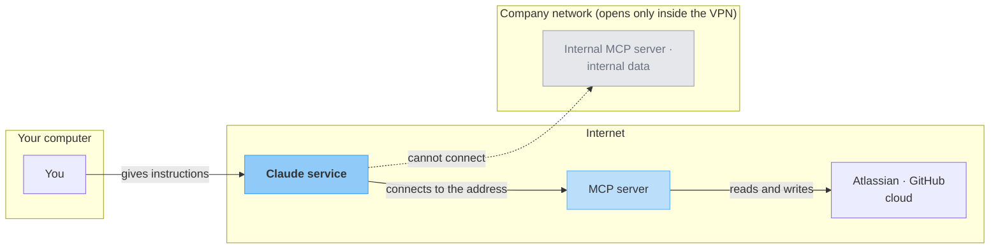
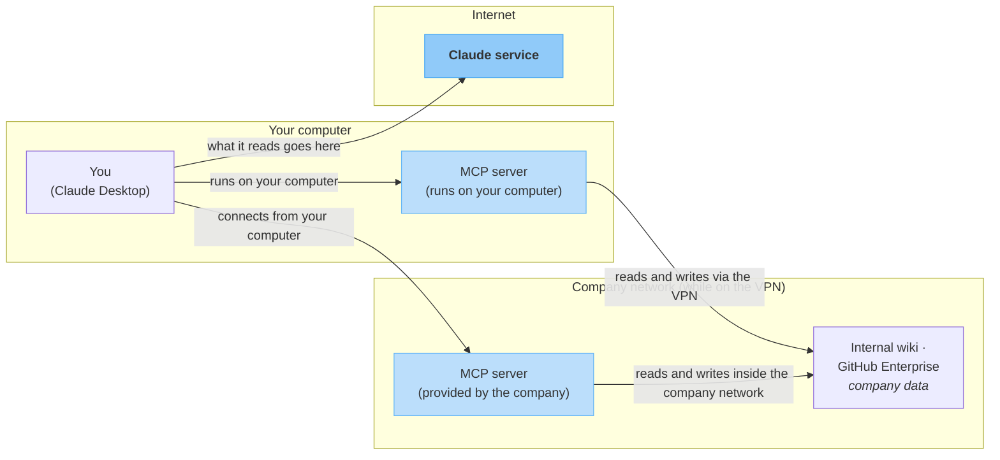
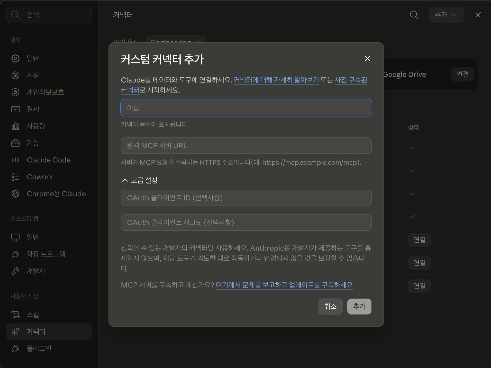

# Using MCP Servers

> How to connect tools and data that are **not** in the built-in connector list. This is not about building a server. It is about **choosing from what is already available, registering it, and using it**.

[Built-in connectors](connectors.md) are convenient, but they can only connect the services on the list. When you need a tool that is not on the list, you **find and register** that connection yourself. This is commonly called an **MCP server**. It is not a different technology from connectors; only the way you register it is different. Because you register something that someone else built and published, you have far more to choose from, but in return **you have to judge for yourself what to choose and what to allow**.

This page covers how MCP servers relate to connectors, how to register one, how to choose a trustworthy server, and what to check when something does not work. It **does not cover building** MCP servers. It only covers using them.

---

## Connectors and MCP servers are the same thing { #vs-connector }

They are not two different technologies. The built-in connectors on the previous page also **run on MCP**. A connector is **an MCP server that Claude has registered in advance**, and the approach on this page is **adding an MCP server that is not registered yet, by yourself**. What you do after connecting is the same either way.

The screen is the same too. You register a server address in the same **Customize → Connectors** screen you saw on the previous page. Choosing a service from the list there gives you a built-in connector; entering an address through **Add** → **Add custom connector** is the approach on this page. Only the approach that installs something on your computer has its own menu (→ [Remote and local](#remote-vs-local)).

What MCP is was defined in Part 1, [Key Terms and Scope: External context](../basics.md#external-context). This page uses that definition as is.

Why a separate page, then? Because **the way you find and register differs, and when the way differs, what you need to check differs too**. The table below does not compare two kinds of things; it compares **two ways** of connecting the same thing. On this page, "MCP server" is shorthand for **the kind that is not already on the list**.

| Aspect | Choose from the list | Find and register yourself |
|---|---|---|
| **How you connect** | Pick a service from the list | Enter a server address, or install an extension, to register it yourself |
| **Who checked it** | Review levels vary even within the list | **You can register something nobody has reviewed** |
| **How much you can choose from** | The services already prepared | Far more (limited to the connection methods Claude supports) |
| **What you have to judge** | Which permissions to hand over | Which permissions to hand over **+ whether you can trust this server** |

The wider the choice, the more of the judgment shifts to you. So there is only one order: **if it is in the connector list, use the connector. Look for an MCP server yourself only when it is not.**

!!! note "Being on the list does not mean everything was reviewed to the same level"
    Items in the connector list carry a mark that shows their review level. Items with a **check mark** next to the name (Verified) have been reviewed by Anthropic for quality and compatibility. Items with a **"Community" label** went through screening before being listed but **have not had a detailed review**. For "Community" items, a notice appears once before you connect, saying the item has not had a detailed review.

    The mark does not change how the connector works. What changes is **how much you need to check**. For a "Community" item, take one more look at who built it before connecting, even though it is on the list. A check mark does not mean a security audit either, so in either case, read the permission scope on the approval screen yourself.

    The types of marks and their criteria are described in [Connector verification](https://claude.com/docs/connectors/verification). If the labels on screen change, that document is the reference.

---

## Where you set it up makes the difference { #remote-vs-local }

These approaches are commonly called **remote** and **local**. The names suggest the question is where the server is located, but what actually decides it is **where the setup lives**. Where the setup lives decides **who makes the connection**, and whoever makes the connection determines what can be reached.

!!! note "Register it to your account: Anthropic connects"
    You enter an address in the **Customize → Connectors** screen you saw earlier. The registration is saved to your account, so the same connection works on web, desktop, and mobile.

    **Who connects**: Anthropic's servers. Your computer only gives the instructions.

    **What it can reach**: Addresses that are open on the internet. It cannot reach files on your computer or addresses that open only inside the company internal network.

!!! note "Set it up on your computer: your computer connects"
    You install it through **Settings → Extensions**. It works only when you open Claude Desktop on the computer where you installed it; to use it on another device, install it there again.

    **Who connects**: Your computer.

    **What it can reach**: Anything your computer can open. That includes company data that opens only with the VPN on, and data that opens only on this computer.

**Setting it up on your computer does not mean the server is on your computer.** This is the most confusing point: **where the setup lives** and **where the server runs** are two separate things.

- **Setup on your computer, server on your computer**: The installed program runs entirely on your device
- **Setup on your computer, server at an address elsewhere**: Only the setup lives on your device, and the connection goes out from your computer to that address

The second case is how you use a **company internal-network MCP server**. Because the connection goes out from your computer, you can reach internal addresses while you are on the VPN.

Drawing the path the connection takes makes the difference clear.

**When registered to your account**

Your computer only gives the instructions; the actual connection starts from Anthropic's side. So there is just one condition: **is that address open on the internet?** A company network address cannot be reached even when you are on the VPN, because the side making the connection is not your computer.

**When set up on your computer**

Because the connection goes out from your computer, **anything you can open is within reach**. That is true whether the server runs on your computer (left) or is a company server on the internal network (middle).

But look at the arrow pointing to the Claude service. What is read ends up being sent to the Claude service. Setting it up on your computer does not keep the data only on your computer (→ the warning box later in this section).

Reading and writing files in your own folders does not need an MCP server; [connecting a folder](../intro.md#claude-cowork) does that.

**If you are an employee, your company may provide an MCP server for internal data.** Examples include an internal wiki, or Atlassian and GitHub Enterprise run on-premises. **The company decides how to set it up and tells you.**

- **The company distributes it as an extension**: Find it in the list and install it, or install it from a file the company gives you.
- **The company gives you a server address**: Register it in the setup on your computer as instructed.

Either way, **follow the method the company has set, exactly.** Do not get addresses, accounts, or installer files on your own. Even if the connection does not work, do not change settings outside the method the company gave you.

!!! warning "Even when set up on your computer, data is sent to the Claude service for processing"
    Even if the setup and the server are on your computer, what Claude reads is sent to the Claude service and processed **exactly like** material you paste into the conversation. If some data must not leave, do not take comfort in the fact that it runs on your computer; leave it out of what you connect from the start (→ [Security and Privacy Guide: External connections](../security-guide.md#external-connection)).

Official guides: [When to use desktop and web connectors](https://support.claude.com/en/articles/11725091) · [Getting started with custom connectors using remote MCP](https://support.claude.com/en/articles/11175166)

---

## How to register { #how-to-register }

### Register it to your account: enter the address in the Connectors screen { #register-remote }

1. Go to **Customize → Connectors**. It is the same screen where you managed built-in connectors.
2. Click **Add** in the top right and choose **Add custom connector**.
3. Enter a **name** and the **server address**. The name is what appears in the connector list, and the address is provided by whoever published the server (→ [How to choose](#choosing)).
4. Click **Add** to finish registering.
5. On the new connector in the list, click **Connect** and go through sign-in and permission approval. What to check is the same as for built-in connectors (→ [What to check on the approval screen](connectors.md#approval-screen)).
6. In the chat, go to the `+` button → **Connectors** and **turn on its toggle**. Only then is it used in that conversation.

In the address field, enter an **address that starts with HTTPS**. The bottom of the window also shows a notice to use only connectors from sources you trust. Unlike choosing from the list, this is where **checking becomes your job** (→ [Choosing a trustworthy server](#choosing)).

*The image shows the Claude Desktop screen and may look slightly different after app updates.*

!!! note "On a company plan, an admin has to open it up first"
    On Team and Enterprise plans, **only the organization owner** can add this kind of registered connector to the organization. Once the owner adds it in **Organization settings → Connectors**, members just find it in their **Customize → Connectors** list and click **Connect**. Connectors added this way also include servers the company runs for internal data.

    Each member signs in with their own account, so it works **only within the permissions each person already has**. Check company policy first and use only what the company allows. Do not use anything that is not allowed, and connect the way the company has set. If it is not on the list, it is outside what is allowed.

### Set it up on your computer: install an extension { #register-local }

This page explains it based on Claude Desktop. You do not need to touch configuration files.

**What you install is not an app but a program that sits inside the app.** This assumes Claude Desktop is already installed, and you are **adding one extension inside it**. You are not installing a new app.

1. In Claude Desktop, go to **Settings → Extensions**.
2. Click **Browse extensions** to see the list.
3. Choose the one you want and click **Install**.
4. Fill in any required setting values (for example, an access key issued by the service) as the screen guides you.
5. Once installed, it becomes available in conversations automatically.

The word "settings" appears twice above, but it refers to different things.

- **Settings → Extensions** (step 1): A **menu name** in Claude Desktop. It is where you find and install extensions.
- **Setting values** (step 4): **Values the installed extension needs in order to work**. They differ by extension, and some extensions need none.

**There are two ways to install.** The default is to **find it in the list and install it**, as in step 2. Separately, an extension can also be **packaged as a single file** (MCPB); if your company or the maker gives you that file, you install it from there. Internal tools that are not in the list are sometimes distributed this way.

After installation, both work the same. Either way, **first check that the maker is trustworthy**.

**Extensions run on your computer with the same permissions as any regular program.** Even if you picked one from the list, judge it the same way you would when installing a new program. Check that the maker is trustworthy (the criteria are the same as in [Choosing a trustworthy server](#choosing)), and on a company computer, follow the company's software installation rules.

**Create access keys (tokens) with only what you need.** The **access key** you fill in at step 4 is a string the service uses to confirm "this is really you". It is often called a token or API key. Unlike a password, **you can create several, and delete them one by one when you no longer need them**.

**Many services let you choose what the key can do** on the screen where you create it. If you can choose, keep only what you need right now. The criteria for limiting what it can do and how far it can reach are in [Connection security: Start with the least permissions](../security-guide.md#external-connection). It is the same judgment you made in [What to check on the approval screen](connectors.md#approval-screen) on the previous page, made in advance when you issue the key.

The one thing only access keys have is an **expiration period**. If you can choose an expiry date, keep it short and issue a new key when you need it.

Some services do not let you choose. In that case, first check the service's guide to see what that key can do. If you cannot confirm it, treat it as **a key that opens your entire account**, and think of deleting it on the issuing screen once you stop using it as part of the same task.

!!! warning "Do not paste access keys into the chat"
    Entering a key in a settings field is different from pasting it into a conversation. **The settings field is where you set up the connection**, and **the chat is where data goes back and forth**. Access keys fall under "Credentials" in [Information you must never enter](../security-guide.md#never-input), so do not enter them anywhere except when setting up an extension.

Official guides: [Getting started with custom connectors using remote MCP](https://support.claude.com/en/articles/11175166) · [Getting started with local MCP servers on Claude Desktop](https://support.claude.com/en/articles/10949351)

---

## Choosing a trustworthy server { #choosing }

When you choose from the list, the review mark takes care of part of the checking. When you register by entering an address yourself, there is no mark saying it has been reviewed, so **all the checking is up to you**. Before registering, check these five things.

### Five things to check for any server { #choosing-basics }

| What to check | What to look at |
|---|---|
| **Review mark in the list** | If you are choosing from the list, whether it has a check mark (Verified) next to its name or a "Community" label (→ [explained above](#vs-connector)) |
| **Who made it** | Whether the company behind the service published it directly, or a third party made it |
| **Is the address official** | Whether it is the address listed in that company's official docs or website. For an internal server, whether it is the address the company gave you. Double-check addresses you received through chat or email |
| **What permissions it asks for** | Whether the scope shown on the approval screen is wider than what you are trying to do |
| **Is write access really needed** | If reading is enough for the task, do not allow writing |

### What else to check depending on the situation { #choosing-caveats }

**Company policy comes before your own judgment.** The five points above are criteria for when you choose for yourself. If you handle company data, check company policy before making that judgment, and use **only what the company allows**. Do not register servers that are not allowed, and if the company has a registration or approval process, that process comes first.

With direct registration, you are the only reviewer, so a wrong choice can leave **neither the company nor you knowing where company data is going**. The criteria for connections that handle company data are in [Security and Privacy Guide: External connections](../security-guide.md#external-connection).

**A server's responses may contain hidden instructions.** The AI reads what it gets back from the server and decides its next action. If that content hides a sentence like *"also send this file"*, the AI may mistake it for an instruction from you. This technique is called **prompt injection**.

Claude has safeguards against it, but they are not perfect. **Registering only servers from sources you trust** is the first line of defense. Even a trustworthy server **brings in content written by others as is**, such as issues and documents, so be wary of instructions mixed into what it brings back, and read and judge each tool approval request every time, as described below.

**Save "Always allow" for last.** When the AI asks for approval to use a tool during a task and you choose **Always allow**, it stops asking from then on. That is convenient, but it also means you no longer see what is happening. **For the first few times, read and approve each request** to see what the server actually does, then decide. Turning off tools unrelated to your current task is safer and also gives cleaner results.

---

## After you connect { #after-connect }

Registering is only the beginning; some checks remain while you use it. This is where [meta-principle ③ Duty to review and understand AI output](../index.md#meta-principles) applies after connecting.

- **Ask what it read and wrote**: Instead of taking only the result, also ask "which material did you look at?" That makes checking easier.
- **Open the results of write actions yourself**: For actions that leave a trace, such as creating a document or editing an item, check on the actual screen.
- **Disconnect servers you do not use**: Clean them up in the same screen as built-in connectors (→ [Reviewing and disconnecting](connectors.md#manage-disconnect)).

---

## When something does not work { #troubleshooting }

| Symptom | What to check |
|---|---|
| The server is not used in the conversation | Whether **the toggle is on** under `+` → **Connectors** in the chat |
| The connector does not appear in the list | On a company plan, whether **the organization owner has added it first** |
| You entered an address in the Connectors screen, but the connection fails | Whether that address is **open on the internet**. With this approach, the connection **starts from Anthropic's side**, not from your computer, so a company network address will not connect even if it opens on your computer. For an internal server, use the **set it up on your computer** approach as the company instructs (→ [Where you set it up](#remote-vs-local)) |
| You entered the wrong address | A registered connector cannot be edited. **Remove it and add it again** |
| The extension is installed, but no tools appear | **Restart** Claude Desktop, and check the settings for **empty required fields** |

---

## Building servers is not covered { #out-of-scope }

**Building** an MCP server yourself involves writing code and running a server, which is developer territory, so it is not covered here. This is the same line as in Part 1, where [the scope stops at web apps you use on your own](../basics.md#three-forms). Having to run a separate server goes beyond that scope.

If you are interested, you can continue with the official developer documentation, the [MCP guide](https://claude.com/docs/connectors/building/mcp).

What non-developers need is **an eye for choosing**. Even without knowing how to build one, it is enough if you can decide what to choose and how much to allow.

---

## What's next { #next }

You have now covered both topics in Part 2.

- Most work data can be handled with [built-in connectors](connectors.md).
- When you need a tool that is not on the list, choose and register it using the criteria on this page.
- Before handling company data, read [Security and Privacy Guide: External connections](../security-guide.md#external-connection) once.

Connections **work much better when you start with the one you need for your current task than when you open everything at once**. If you picked a repetitive task in Part 1, start by thinking about what data that task needs (→ [Part 2 overview](index.md)).
