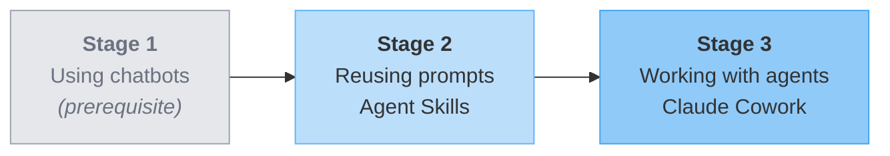
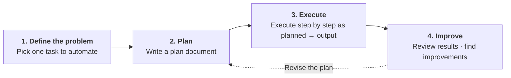

# Practical AI Training

> A practical AI training site for non-developers.

!!! info "About this English edition"
    This is an English translation of the Korean original as of 2026-10-21. The Korean version remains the reference. Screenshots show the Korean-language Claude app, and the lab materials on GitHub are in Korean.

---

## Who: Who is this training for? { #who }

This training is for **anyone who has used a chatbot AI at least once**. It suits people who now want to go beyond simple questions and answers and **use AI more actively** in their own work or studies.

### Who should attend

| Track | Who is it for? |
|------|--------------|
| **Employees (non-developers)** | Working professionals who can use the AI tools provided by their company |
| **Students and general users (non-developers)** | People who want to use AI more in their studies and daily life |

There are three broad areas where AI can strengthen what you can do.

- **Individual**: Handle your own work, studies, and daily life more efficiently
- **Organization**: Lead AI adoption across a team or the whole company and set standards for its use
- **Products and services**: Build AI features into your company's products and release them

This training focuses on **strengthening individual capability**. If you want to bring AI into your team or company, or add AI features to your company's products, a different kind of training will suit you better.

!!! note "Common prerequisite + self-check"
    Both tracks assume you have **used a chatbot AI (Claude, ChatGPT, Gemini, etc.)**. If you can answer **Yes** to all three questions below, you can join this training.

    - [ ] I have asked a chatbot AI a question and received an answer at least once
    - [ ] When a question didn't work well, I have rephrased it and asked again
    - [ ] I have felt that an AI's answer was inaccurate or incomplete

    If you have no experience at all, we recommend using a chatbot AI a few times before you join.

However, **students who want a career in software development** are not the audience for this training. We recommend taking a separate course designed for developers.

### Prerequisites

This training requires three things.

- Basic computer skills (uploading and downloading files, using a web browser)
- Basic web searching
- Some experience having short conversations with a chatbot AI

On the other hand, it does not require:

- Programming or coding knowledge
- Theory of prompt, context, or harness engineering
- Advanced skills in any particular AI tool

### Preparation { #preparation }

All labs in this training are done in Claude, so **a paid plan is required.** You need a paid plan to use Claude Cowork and Claude Code, and which plan you use depends on your track.

- **Students and general users**: Join with an individual plan at Claude Pro or above (Pro or Max).
- **Employees**: Use only the Team or Enterprise plan your company has contracted. **Individual plans cannot be used, whether free or paid.** Handling company work and materials on an individual plan violates security policy, because individual plans fall outside the company's data protection agreement (storage, training, isolation). The background is covered in [Security Guide: The company enterprise environment](security-guide.md#enterprise-ai).

You can compare plans at [Claude plans](https://claude.com/pricing). Please finish creating your account and paying (for employees, getting a company account issued) before the training starts.

!!! note "What participants prepare"
    - Your own laptop (with a web browser that runs smoothly)
    - **One idea** for a work or study task you repeat (used as your lab topic)
    - **Paid Claude plan**: Individuals need Pro or above / **Employees need the company Team or Enterprise plan (individual plans strictly prohibited)** (see above)
    - **Install Claude Desktop** (needed for all labs; depending on the step, needed from stage 1)
    - (Employee track) Check in advance that you can log in to your company's AI tools: the instructor will guide you before the training starts

!!! note "What the instructor prepares (participants don't need to worry about this)"
    - **Sample data** for the labs (samples that contain no personal information)
    - Lab guide materials and presentation slides

How to check your plan's usage and limits (including screenshots of the settings screen and Claude Desktop) is covered in [Tools and Products: How to check usage](intro.md#claude-usage).

---

## Why: Why learn to use AI?

### Reasons to learn to use AI

There are three reasons.

1. **Saving time**: What is one hour of your time worth? If you can save one hour of repetitive work every day, that adds up to 250 hours a year (assuming 250 working days a year). Time is your most precious resource.
2. **Staying employable**: AI will not replace you. People who use AI well will replace you. The baseline for hiring, evaluation, and performance is shifting fast.
3. **Expanding what you can do**: You can now automate your own work without knowing how to code. Large-scale systems may still be hard, but personal automation (software) for your own work, studies, and daily life is now open to non-developers too.

### The value software creates

The software we use every day has created value in three ways.

- **Providing capabilities**: It makes possible things that used to be impossible or hard (e.g., real-time translation, navigation)
- **Saving time**: It handles in a short time what would take a person a long time to do (e.g., booking train tickets, online banking)
- **Reducing costs**: It cuts the costs of people, places, travel, and so on (e.g., online banking, kiosks, video conferencing)

> With the arrival of AI, the path to creating this value is now **open to non-developers too.**

---

## What: What you will take away

### Training goal

> **Be able to build, on your own, outputs you can use again and again.**

The goal of this training is not to study AI theory. The goal is for you to be able to build **outputs you can use repeatedly in your own work or daily life**, even after the training ends. **One task of 30 minutes to 1 hour that you repeat every week** is a good starting point.

### The three stages of AI use and where you are { #stage-model }

Giving AI fresh instructions every time is a fine place to start. But many tasks **don't end after one round**: reports due every week, meeting notes that look much the same each time, study summaries you redo every semester. If you start repetitive work from scratch each time, you type the same instructions again, and because the results differ slightly every time, you end up reviewing them again.

So you decide, based on the nature of the work, whether to instruct AI each time or to build something once.

- **Giving direct instructions**: Suits one-off tasks and tasks where you are **still exploring** what you want.
- **Building it as software**: Suits repetitive tasks and tasks that need the **same format and quality** every time. This is what this training emphasizes.

!!! tip "Key point: non-developers build software too"
    Don't stop at "asking AI every time." Move on to **"building your own software with AI to automate repetitive work."**

This training divides this progression into **three stages**. Most participants join having **already passed Stage 1**, and this training focuses on **Stages 2 and 3**. (What the "chatbot" in Stage 1 and the "agent" in Stage 3 mean is defined in [Key Terms: Chatbot vs. agent](basics.md#chatbot-vs-agent).)

| Stage | What do you do? | Representative tools and features | In this training |
|------|-------------|--------------|------------|
| **Stage 1: Using chatbots** | Get answers through one-off conversations | Claude, ChatGPT, and Gemini web chatbots | **Prerequisite** (already experienced) |
| **Stage 2: Reusing prompts** | Turn reusable custom prompts and chatbots into assets | **Skill basics** | **Stage 2 labs** |
| **Stage 3: Working with agents** | Run agents that automate local files and tasks | **Claude Cowork**, Claude Code | **Stage 3 labs** |

The three stages above describe how you learn. [Key Terms and Scope: The nature of outputs](basics.md#three-forms), which divides outputs by **determinism and cost**, is a **separate classification**. The two overlap at the beginning, and the output-based classification shows where applications begin. Within it, this training covers up to web apps you use by yourself.

---

## How: How does the training work?

### Lab approach: plan → execute

Instead of long theory lessons, this training works by **writing a plan document first and then executing it step by step**.

You may wonder how this differs from just asking a chatbot whatever comes to mind. Making a plan first has three benefits.

- **Your thinking becomes organized and concrete**: Vague needs in your head become clear once you write them down.
- **AI understands you more accurately**: Starting from a clean, well-organized plan gives consistent answers and keeps the conversation from dragging on.
- **It saves time and cost**: If AI misunderstands and has to redo the work, **the work time can easily double.** Just as miscommunication between people is costly, the same is true with AI.

!!! example "Vague instruction"
    "Make me something that tells me today's weather in Seoul."

    → AI decides the scope and format on the spot and builds it right away. If the result isn't what you expected, you have no reference point for what went wrong, so you end up asking again from scratch.

!!! example "Instruction through a plan document"
    "I want to create a Seoul weather report every morning. It must always show four items in the same order: temperature, humidity, fine dust, and whether I need an umbrella. First, just draft a plan."

    → You review the plan you receive, then have it executed. Because what counts as "done" is decided in advance, you can check the result against that standard.

### Meta-principles for using AI { #meta-principles }

These are five **common principles** that still hold when tools and labs change.

!!! note "Five meta-principles"
    - **① Separate planning from execution**: Get just the plan first, review it, then have it executed.
    - **② Separate data from view**: Keep content and presentation apart so you can reuse each.
    - **③ Duty to review and understand AI output**: Use output only after reading and understanding it; how deeply you review depends on its impact.
    - **④ Manage your context (conversations)**: Don't drag one conversation on forever; start a new one when certain criteria are met.
    - **⑤ Assigning a persona (role)**: Recommended for setting tone and format; be cautious about using it to grant expertise.

Each one is covered in detail below.

---

#### ① Separate planning from execution

Don't hand AI "plan + execute" all at once. **Get just the plan first, review it, then have it executed.**

1. **Ask for the plan only**: "Here's what I want to do. Just make a plan."
2. **Review the plan**: Fix missing steps and anything that differs from what you intended.
3. **Ask for execution**: "Good, go ahead with that plan."

**A plan should include at least these two things.**

- **Goal (What)**: What you want to do
- **Definition of done (checklist)**: What it takes to say the work is finished

If the task is complex, also get an **execution plan (How: step-by-step tasks)**. After the work is done, add an **execution summary (results)** and use it as input for the next step.

If you hand everything over at once, AI makes its own judgment calls and moves ahead, so **the result is hard to control.** Splitting it in two creates a **review step**, so you don't lose control.

This follows the same idea as this training's [three-stage model](#stage-model). In the structure where a Skill turns the plan into an asset (Stage 2) and an agent executes it (Stage 3), the learner's review step is built in explicitly.

---

#### ② Separate data from view

When you have AI create outputs, keep the **content (data)** and the **presentation (view)** separate.

- **Data**: The values themselves (numbers, text, tables, Excel, etc.)
- **View**: The frame that displays the data ([Markdown](basics.md#markdown), HTML, slides, etc.)

A well-made view (template) can be reused with many sets of data, and you can also create several views from the same data. If you mix them, you'll have to ask for everything from scratch again next time.

The [lab series](labs.md) of this training has examples. `step01-weather` is split into weather values (data) and an HTML report template (view), and `step04-wrong-answer-note` into an Excel file of recognition results (data) and Markdown and HTML (view).

---

#### ③ Duty to review and understand AI output

Even if you had AI build something, **you must read and understand the output yourself** before you use it.

- **Don't use output you haven't read.** This applies equally to Markdown, HTML, Excel, and Skill instructions.
- **If you don't fully understand it, have AI explain it.** Ask again, "Why did you build it this way? What does this part mean?", and go over it.

The [lab series](labs.md) of this training is done **with prompts only**, without writing anything by hand. But not writing by hand doesn't exempt you from review. On the contrary, precisely because you don't write it by hand, **you need to make a more conscious effort to understand it in depth**. Otherwise, you may keep using a flawed output without noticing.

That said, this doesn't mean you should review every output with the same intensity. **How deeply you review depends on the output's impact.** You don't need to pick apart every line of a light, throwaway output. On the other hand, the more an output is **reused or affects other people**, the more deeply you should look at it. Even for outputs that are hard to read line by line, like code, at least check **what this tool processes and how, where it stops if it fails, and how it handles sensitive data**.

The most direct example in the labs is `step04-wrong-answer-note`. The flow is designed so that **you read and review it once yourself** before passing the Excel file of recognized results from your child's answer sheet on to the next step.

---

#### ④ Manage your context (conversations)

**Context** is the **bundle of all inputs** that AI is looking at in a single conversation: all the messages exchanged so far, pasted documents, and attached files. AI rereads this whole bundle from the beginning every time it produces an answer. So the longer a conversation gets, **the more AI has to look at in one go**, and once it passes a certain limit, earlier content starts to blur or get cut off.

Don't drag one conversation on forever. When certain criteria are met, **start a new conversation**.

**Signals to start a new conversation**

- **When the topic changes** (e.g., moving from organizing meeting notes to writing a weekly report).
- **When the planning stage ends and you move on to execution** (applying [meta-principle ①](#meta-principles) at the context level). Once you have reviewed and agreed on the plan, keep only that plan as input and **start execution in a new conversation** (when planning, execution, and review are mixed in one conversation, the flow gets muddled).
- **When AI starts forgetting or contradicting what it said earlier**: It's a sign that answers are wobbling even when you repeat the same instruction.
- **When the conversation has become too long**: **Just as people lose focus when a meeting runs long**, AI loses track of earlier context too. It's safer to break off at a point where "the results of the work so far" can be summarized.

**How to start a new conversation**

- **Claude.ai chatbot and Claude Cowork**: The **New chat** button in the sidebar.
- **Claude Code**: The `/clear` command.

**Bring a summary along, like meeting minutes.** When a meeting is split into two sessions, you bring the **minutes** to the next one to keep the context going. In the same way, when you move to a new conversation, condense and bring along the **key results (decisions, completed work, next steps)** of the previous conversation (e.g., "So far we've decided A, B, and C. Next is…"). You don't need to paste the whole history.

These "minutes" play the same role as the **plan document and execution summary** mentioned in [meta-principle ①](#meta-principles). Once well organized, they become clean input for the next conversation, and you stay in control even when you open a new conversation. If you pile everything into one conversation, the input gets muddled and you lose control.

??? note "Reference: How big is the context?"
    According to the official documentation, the latest models (Fable 5.1, Opus 5.5, and Sonnet 5.5) have a context window of **1M tokens**. In claude.ai chat, the latest models also use **1M on all paid plans**, while some previous-generation models use 500K ([Claude.ai context limits](https://support.claude.com/en/articles/8606394)). In Claude Code, some previous-generation models that have 500K in chat can also use 1M, and conditions may apply depending on the model and plan. For the technical background, see [Context windows: Claude API docs](https://platform.claude.com/docs/en/build-with-claude/context-windows).

---

#### ⑤ Assigning a persona (role): this course's current position

On whether **assigning a persona**, such as "You are an expert in ~", helps the quality of the results, this course's current position is **recommended with conditions**.

**We look at two cases separately.**

- **A persona for setting tone and format** (e.g., *"Explain it in the tone of an official document"*, *"Explain it so an elementary school student can understand"*). ➜ **Recommended**. A practical tool for getting results in a consistent format.
- **A persona for granting expertise** (e.g., *"You are a lawyer with 20 years of experience; review this contract"*). ➜ **Be cautious**. Recent AI often answers at the same level without a persona, and giving it false authority can actually increase **the risk of it confidently stating wrong answers**.

Decide whether it helps by **comparing the results with and without it** in your own work. We don't recommend the habit of always adding a "You are an expert in ~" line.

Across the series, stronger control comes from [meta-principle ③, reviewing outputs](#meta-principles). Rather than *hoping* for good results through a persona, it's more reliable to *read and review* the results you receive yourself.

---

## See also

- [Lab series](labs.md#series): Example lab outputs for each track, organized by step
- [Security and Privacy Guide](security-guide.md): Security principles you must know when using AI
