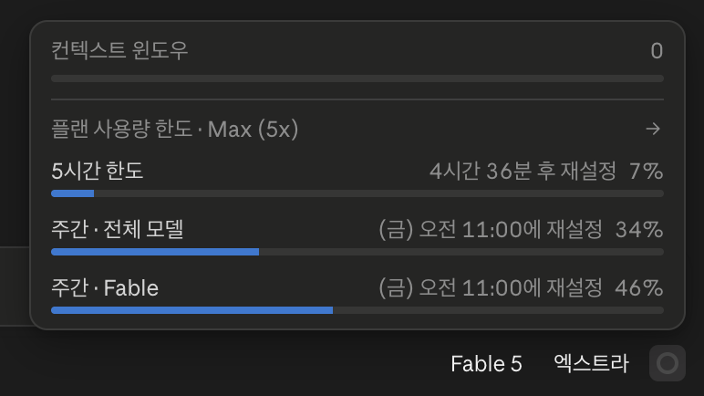
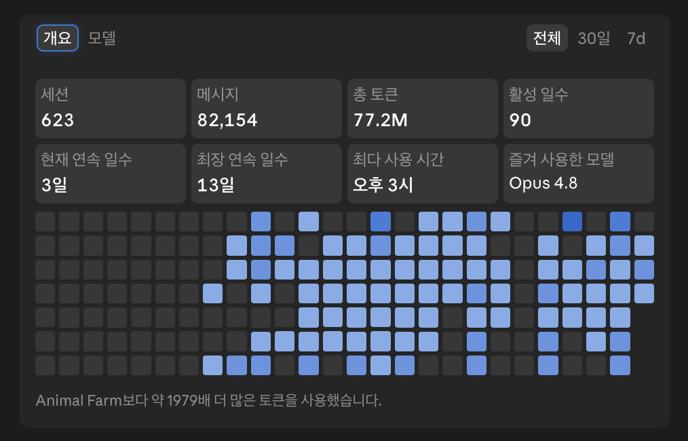
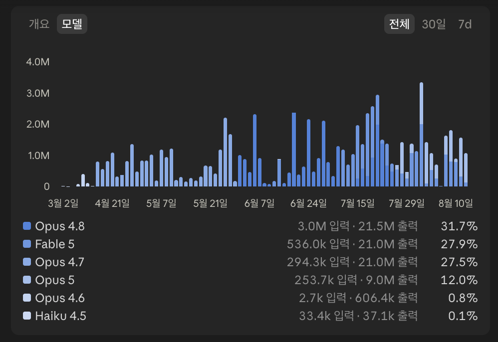

# AI Tools and Products: The Generative AI Landscape and Claude

> This page brings together the big picture of the generative AI market and the tools used in this training (the Claude ecosystem).
> Open it when you need to choose a tool, compare features, or check usage. If the terms are unfamiliar, you can read [Key Terms and Scope](basics.md) first.

---

## Introduction to generative AI

!!! note "About terms"
    On this page, "chatbot" and "agent" are short for **AI chatbot** and **AI agent**. What each of these two ways of using AI means is defined in [Key Terms: Chatbot vs. agent](basics.md#chatbot-vs-agent).

### Leading products: Claude · ChatGPT · Gemini { #products }

Generative AI means **AI that creates new outputs** such as text, code, and images. Among conversational products, these three are the most widely known.

| Product | Made by | In one line |
|------|---------|------------|
| **Claude** | Anthropic | Strong at handling long text and documents, and at coding and agent work |
| **ChatGPT** | OpenAI | The best-known conversational AI. Strong in voice and image (multimodal) features |
| **Gemini** | Google | Works naturally with Google Search and Workspace |

You may wonder which product is best, but each has different strengths, and even the same product changes its models and features quickly every month. **The time for picking "the one right answer" has passed.** It is more practical to keep learning one or two that fit your work and environment.

The labs in this training run on **Claude only**. Experience with chatbots (Stage 1) feels similar whichever product you use, so it is fine to start with the tool you know. However, the **Stage 2 and 3 labs use Claude's asset-building and agent features**, so we standardize on Claude (for background, see [Home: Preparation](index.md#preparation)).

#### Don't stop at chatbots: the same companies also make coding agents

The chatbot and the coding agent made by the same company **come as a pair**. Many people are familiar with the chatbot but know little about the agent, yet **the agent is where serious automation happens**.

| Company   | Chatbot (what most people know) | Coding agent                     |
|-----------|---------------------------------|----------------------------------|
| Anthropic | Claude                          | **Claude Code**                  |
| OpenAI    | ChatGPT                         | **Codex**                        |
| Google    | Gemini                          | **Antigravity**                  |

Anthropic also offers **Claude Cowork**, an agent for non-developers. The Stage 3 labs in this training use **Claude Cowork**. Claude Code has a higher barrier to entry for non-developers, so it is introduced only as a supporting tool (see [Introducing Claude](#claude) below for details).

---

## Introducing Claude { #claude }

All the tools used in this training belong to the Claude ecosystem. **The chatbot and the agents come as one bundle**, so the whole [three-stage model](index.md#stage-model) flows naturally in the same environment.

| Product           | What it is                                         | Stage in this training               |
|-------------------|----------------------------------------------------|--------------------------------------|
| **claude.ai**     | Conversational chatbot on web and mobile           | Stage 1 (prerequisite)               |
| **Claude Cowork** | General-purpose agent that works directly with files and tools | **Main Stage 3 labs**    |
| **Claude Code**   | Coding agent for the terminal and IDE              | Stage 3 supporting tool (optional)   |

> The **Cowork and Code labs** in this training require a **paid plan**. Individuals need **Claude Pro or higher**; employees use their **company's Team or Enterprise plan** (individual plans are not allowed). **Installing Claude Desktop** is required for all labs. See [Home: Preparation](index.md#preparation).

---

### Feature comparison at a glance { #claude-comparison }

This table sums up how the three products differ in what they can do. **Whether a product can access local files and the terminal** is the key line between chatbots and agents.

| Feature | claude.ai | Claude Cowork | Claude Code |
|:-----|:---------:|:-------------:|:-----------:|
| Web search | ✓ | ✓ | ✓ |
| Upload files to a conversation | ✓ | ✓ | ✓ |
| File and system access | ✗ | △ Connected folders only | ✓ Full |
| Run terminal commands | ✗ | △ Isolated VM | ✓ Full |
| Agent Skills | ✓ | ✓ | ✓ |
| Connect external tools and data (connectors, MCP servers) | ✓ Remote · ✗ Local | ✓ Remote · △ Local | ✓ Full |
| Call external APIs | ✗ | △ Network rules | ✓ Full |

> **Legend**: ✓ Supported · △ Limited or conditional · ✗ Not supported

The **✓ Remote · △ Local** in the table is about **where the MCP server you connect to runs**.

- **Remote** covers every case where the server runs **outside your computer**. Services you connect with built-in connectors, MCP servers published on the internet, and MCP servers your company provides on its **internal network** all belong here.
- **Local** is the case where the server runs **inside your computer**, and you have to install it on every computer you want to use it on. The claude.ai web app runs in a browser and cannot run a server on your computer, so it cannot use local servers (✗). Cowork in Claude Desktop can use them under certain conditions (△), and Claude Code supports them (✓).

Separately from where the server runs, there is another distinction: **where you put the setup**. How the two fit together is covered in **[Part 2: Where you set it up](connect/mcp-servers.md#remote-vs-local)**.

---

### Model comparison: Fable · Opus · Sonnet · Haiku { #claude-models }

Claude is not a single model but **several model families**. claude.ai, Cowork, and Code all share the same families, and you can pick one directly on screen. **On top of** the existing three families, the top-tier model **Fable** has been added. It does not replace the existing families; it adds one more tier.

| Model family | Position in one line                    | Good situations                                               |
|------------|-------------------------------------------|---------------------------------------------------------------|
| **Fable**  | Smartest (top tier, newly added)          | Discussing the hardest problems, large autonomous tasks that take a long time |
| **Opus**   | The default for deep reasoning (strong reasoning, moderate speed) | Discussing topics you don't know well yourself, deep analysis, multi-step agent work |
| **Sonnet** | Balance of smart and fast (default for everyday work) | Instruction-following tasks such as polishing text, searching, summarizing, find-and-replace |
| **Haiku**  | Fastest (light and repetitive tasks)      | Simple questions where a short answer is enough, repeating the same pattern |

!!! tip "Which model should I use?"
    The deciding factor is **how much reasoning the task needs**. If you need to work through a topic you don't know well yourself, use **Opus**. If following instructions is the core, such as searching, find-and-replace, or summarizing, **Sonnet** is enough. If you're unsure, start with **Opus**. Anthropic also [recommends starting most tasks with Opus 5.5 if you're not sure which model to use](https://platform.claude.com/docs/en/models/overview). **Fable** is the option above that. Consider it for the hardest problems where even Opus falls short, or for long autonomous tasks.

> The model families stay relatively stable, but new ones can be added, as Fable was, and version numbers (e.g., Fable 5.1, Opus 5.5, Sonnet 5.5, Haiku 4.5) are updated often. You can check the latest specs and availability by plan in [Anthropic's official model overview](https://platform.claude.com/docs/en/models/overview).

---

### Effort level: how much care the same model puts in { #claude-effort }

If choosing a model decides **whom to hand the work to**, the **effort level** (effort) is a control that decides **how much care the same model puts into the work**. You set it separately from the model. With the same model, raising effort means it thinks more deeply before answering, checks its own results, and examines easy-to-miss edge cases more often.

| Level | How it works |
|------|---------------|
| `low`    | Answers quickly and concisely. Quality may drop a little in exchange, and it may skip thinking on easy problems |
| `medium` | Balances speed, usage, and quality |
| `high`   | Thinks and checks as much as needed |
| `xhigh`  | A level beyond `high`, for long tasks that take 30 minutes or more |
| `max`    | Puts in maximum effort without holding back on usage |

> These level names are Claude's. OpenAI (ChatGPT) has similar levels, plus lower ones (`none` · `minimal`).

Raising the level makes even the same task **take longer and use more of your usage**. How long it takes varies greatly by task, so treat the numbers below only as an example of the scale of the difference. In an example from a post on the Claude blog, Fable 5.1 in Claude Code was given the same task (building a program that filters out dangerous code sneaked into web pages). It took about 2 minutes at `low` and about 33 minutes at a high level. At the high level, it added checks such as attacking the program it built in several ways to find gaps ([Spending your effort](https://claude.dev/blog/spending-your-effort/)).

Each model has a **default level** it uses when you don't set effort.

| Model | Default level |
|------|-----------|
| Fable 5.1  | `high` |
| Opus 5.5   | `medium` |
| Sonnet 5.5 | `high` |
| Haiku 4.5  | Does not support effort |

These values are the defaults in the [official Claude documentation](https://platform.claude.com/docs/en/build-with-claude/effort). In Claude Code, Sonnet 5.5 also starts at `medium`, and in claude.ai, the menu for choosing a level shows each model's default.

In claude.ai and Claude Desktop, you change the level from the menu that opens when you click the model name next to the input box. In Claude Code, use the `/effort` command. Depending on your plan or company settings, the levels you can choose may be limited ([Changing model and effort settings](https://support.claude.com/en/articles/8664678)).

!!! note "Things to know when using effort"
    - **Available levels and defaults differ by model.** Not every model supports all five levels, and some models, such as Haiku 4.5, don't let you choose effort at all.
    - **Even with the same level name, how much a model thinks differs by model.** Rather than carrying over a level you used with another model, adjust it while watching the results.
    - **Effort is a signal of how much care to take, not an exact cap.** Even at a low level, a hard enough problem still gets some thinking, just less than the same problem would get at a higher level.

The higher the level, the faster your usage fills up. You can see how much you've used so far in [How to check usage](#claude-usage).

---

### claude.ai (Chat): where Stage 1 starts { #claude-ai }

A conversational chatbot you use right in a web or mobile browser. It suits **one-off tasks** such as quick questions, organizing information, and polishing text. This training assumes, as a **prerequisite**, that you are already comfortable using it this way.

---

### Claude Cowork: the main stage for Stage 3 { #claude-cowork }

An agent where **the AI opens files and does the work itself**. It suits automating repetitive tasks, batch-processing local files, and workflows that span several steps.

Work sessions run in the cloud, so you can pick them up anywhere: web, desktop, or mobile. However, **working directly with files on your computer, and connections you set up on your computer, only work in the desktop app** (→ [feature comparison](#claude-comparison)). The labs use both, so [installing Claude Desktop](index.md#preparation) is a requirement for joining.

When working with files on your computer, you **choose one folder to work in and open it in Cowork**. This is called **connecting a folder**. Claude can read and write only the files inside the folder you connect.

!!! note "Cowork's protection model"
    According to [Anthropic's official guide](https://support.claude.com/en/articles/13345190), Cowork runs with **layered protection**.

    - **Code execution isolation**: shell commands and code that Claude writes run inside an isolated virtual machine (VM), separate from your main operating system.
    - **Controlled file and network access**: Claude can read and write only files in the folders you connect, and network access follows the egress settings (outbound network rules) you configure.

---

### Claude Code: the Stage 3 supporting tool { #claude-code }

A **coding agent** that works in the terminal and IDE (the Anthropic entry among the [coding agents by company in the table above](#products)). It suits serious coding and writing automation scripts. Because the command-line interface is a barrier to entry, this training covers it only as an **optional introduction**, and you don't need it to take part.

---

### How to check usage { #claude-usage }

Pro, Max, and Team plans have limits by time and period. You check your usage on **two screens**: *the limit numbers* (Settings) and *cumulative usage* (Code tab).

#### ① Limit numbers: Settings → Usage

You check this on the same screen in both **the claude.ai web app** and **Claude Desktop**.

| Item on screen | Meaning |
|-----------|------|
| 5-hour limit | How much you've used across all models, and the time left until the next reset |
| Weekly limit | How much you've used across all models, and when it next resets |

#### ② Cumulative usage: Claude Desktop's Code tab → usage ring

Open Claude Desktop, select the **Code** tab on the left, and click the **usage ring** at the bottom right of the screen (next to the current model name). A short summary opens first.

Click the arrow (→) here to open the full usage screen, where you can see more detail in two tabs: **Overview** and **Models**.

**Overview: cumulative usage at a glance (sessions, messages, tokens, streak days, favorite model)**

**Models: daily token distribution by model**

Tasks that need a lot of reasoning and simple instruction-following can differ greatly in tokens even over the same amount of time. Look at the ratio by model (Fable, Opus, Sonnet, Haiku), **choose the model and effort to match the nature of the task** (→ [model comparison](#claude-models) · [effort level](#claude-effort)), and see the difference for yourself.

*The images may show an older screen if the Claude Desktop UI changes. This page is responsible for keeping the screenshots up to date.*

!!! tip "Cowork uses up your limit faster than chat"
    According to the [official guide](https://support.claude.com/en/articles/11647753), *work in Cowork consumes more usage than chatting with Claude.* That's because it involves many steps and tool calls. If you keep simple questions and organizing in chat and use Cowork only for real work, your limit lasts longer.

**If you've reached your limit**: wait for the 5-hour limit to reset, upgrade your plan, or keep going by [buying extra usage](https://support.claude.com/en/articles/12429409). claude.ai, Cowork, and Claude Code all share **one usage pool**.

!!! note "Checking Claude Code usage (optional)"
    Inside a terminal session, use `/usage` to check your plan limit usage and `/extra-usage` to manage extra usage. For plan-specific guides, see the official docs below.

    - [Using Claude Code with your Pro or Max plan](https://support.claude.com/en/articles/11145838)
    - [Using Claude Code with your Team or Enterprise plan](https://support.claude.com/en/articles/11845131)

> Official guide: [Claude Code Desktop: Check usage](https://code.claude.com/docs/en/desktop#check-usage)

---

## Official docs and references { #official-references }

Official resources worth checking when you want to learn more about Claude after this training.

### Getting started

- [Claude models overview](https://platform.claude.com/docs/en/models/overview): model families, latest specs, differences between versions
- [Getting started with Claude Cowork](https://support.claude.com/en/articles/13345190): how to work project by project
- [Claude Code overview](https://docs.claude.com/en/docs/claude-code/overview): the coding agent for the terminal and IDE
- [Claude Academy](https://academy.claude.com/): learning guides and courses for each product

### Building assets and extending

- [What are Skills?](https://support.claude.com/en/articles/12512176): turn repetitive work into a reusable asset with Skills
- [MCP guide](https://claude.com/docs/connectors/building/mcp): developer docs for when you **build** an MCP server yourself. For how to use MCP servers, [Part 2: Using MCP Servers](connect/mcp-servers.md) is enough

### Operations and support

- [Claude plans](https://claude.com/pricing): plan comparison and pricing
- [Official Support home](https://support.claude.com/en/): the English help center
- [Claude Status](https://status.claude.com/): check service outages and maintenance

---

## See also

- [Home: the Why, What, and How of this training](index.md)
- [Home: Preparation](index.md#preparation): what to prepare in advance, such as Claude Pro and installing Claude Desktop
- [Home: Three-stage model](index.md#stage-model): the stages of AI use this training covers
- [Part 2: Connecting Tools and Data](connect/index.md): connecting external materials with connectors and MCP servers
- [Security and Privacy Guide](security-guide.md)
