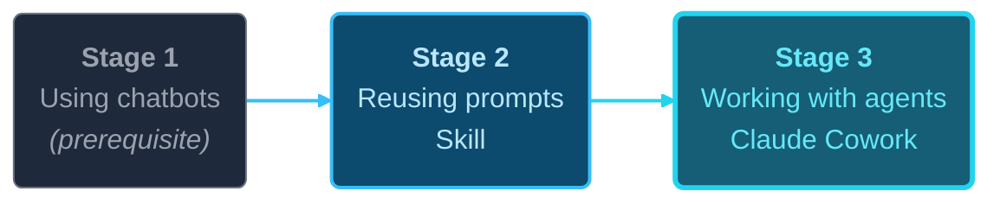
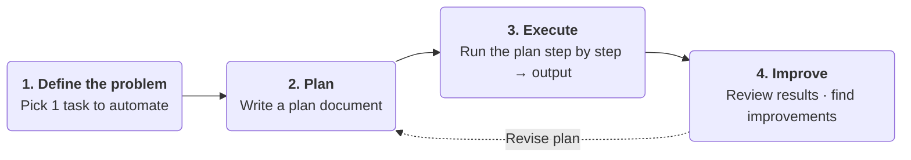
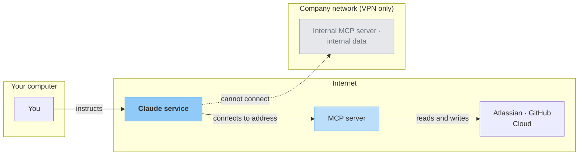
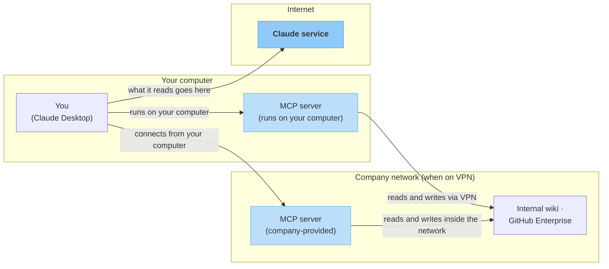

# Practical AI Onboarding

Practical AI training for non-developers

English edition · translated from the Korean original as of 2026-10-21

  <a href="https://github.com/scroogy-dev/ai-onboarding" target="_blank" class="slidev-icon-btn">
    <carbon:logo-github />
  </a>

---
layout: default
---

# Today's Agenda

01

Who

Who this training is for

02

Why

Why learn to use AI

03

Terms & Scope

Chatbots vs. agents, model + harness

04

Tools & Products

The generative AI landscape and Claude

05

What

What you take away: building it yourself

06

How

How the training works

07

Security

Using AI safely

Part 2

Tools & Data

Connect your own data with connectors and MCP (separate session)

---
layout: section
---

# Who

Who is this training for?

---

# Who This Training Is For

This training is for **anyone who has used a chatbot AI at least once**.

It suits people who want to go beyond simple Q&A and **use AI more actively** in their work and studies.

| Track | Who is it for? |
|------|--------------|
| **Employees (non-developers)** | Working professionals who can use company AI tools |
| **Students and general users (non-developers)** | People who want to use AI more in study and daily life |

---

# Shared Prerequisite + Self-Check

Both tracks assume **experience using a chatbot AI**.
If you can answer **Yes** to all three questions below, **you are ready to join.**

☐

I have asked a chatbot AI a question and gotten an answer at least once

☐

When a question did not work well, I have rephrased it and asked again

☐

I have felt that an AI's answer was inaccurate or incomplete

If you have no experience at all, we recommend trying a chatbot AI a few times before joining.

---

# Student Track: Who It Is Not For

**Students aiming for a career in software development** are **not the audience** for this training.

We recommend a separate course that focuses on programming and development.

---

# What This Training Builds: Personal Capability

AI can strengthen capability at **three levels**.

- **Personal**: efficiency in your own work, study, and daily life
- **Organizational**: leading AI adoption and setting usage standards for a team or company
- **Products and services**: building AI features into your company's products and services

This training focuses on **personal capability**. Organizational adoption and productization are out of scope.

---

# Prerequisites

Required

- Basic computer skills (uploading and downloading files, using a web browser)
- Basic web search
- Some experience chatting briefly with a chatbot AI

Not required

- Programming or coding knowledge
- Theory of prompt, context, or harness engineering
- Advanced skill with any specific AI tool

---

# Preparation: Paid Plan Required (varies by track)

All labs run on Claude: Cowork and Code **require a paid plan.**

**Students and general users (individual)**

**Claude Pro or higher** (Pro, Max) individual plan

**Employees (company work)**

**Individual plans strictly prohibited** (free or paid) → **Company Team or Enterprise plan only**

Plans: [claude.com/pricing](https://claude.com/pricing) · Finish sign-up and payment (employees: get your company account) **before the training starts**

---

# Who Prepares What

**Participants prepare**

- Your own laptop (web browser)
- **One idea** for a work or study task you repeat
- **Paid Claude plan**: individuals Pro or higher / **employees: company Team or Enterprise (no individual plans)**
- **Install Claude Desktop**
- (Employees) Check your login to company AI tools in advance

**Instructor prepares** (nothing for participants to worry about)

- **Mock data** for the labs (no personal information)
- Lab guide materials
- Presentation slides

---
layout: section
---

# Why

Why learn to use AI?

---
layout: center
class: text-center
---

Why learn to use AI ①

# Save Time

What is one hour of your time worth?

If you save one hour on a task you repeat every day, that is **250 hours a year**.

(assuming 250 working days a year)

Your most precious resource is <strong>time</strong>.

---
layout: center
class: text-center
---

Why learn to use AI ②

# Career Survival

AI will not replace you. 
People who use AI well will replace you.

The <strong>baseline</strong> for hiring, evaluation, and performance is shifting fast.

---
layout: center
class: text-center
---

Why learn to use AI ③

# Expand What You Can Do

Even without coding, you can now automate your own work.

Large-scale systems may still be hard, but
<strong>personal automation (software)</strong> for your work, study, and daily life 
is now open to non-developers too.

---

# The Value Software Creates

The software we use every day creates value in **three ways**.

New capabilities

Makes hard or impossible tasks **possible**

Real-time translation · Navigation

Time savings

Does slow manual work **in less time**

Train tickets · Online banking

Lower costs

**Cuts the cost** of people, places, and travel

Online banking · Kiosks · Video calls

With AI, the path to creating this value is <strong>now open to non-developers too.</strong>

---
layout: section
---

# Key Terms and Scope

Chatbots vs. agents, model + harness, types of output

---

# Chatbot vs. Agent: "Asking" vs. "Delegating"

Chatbot: Asking

You ask, AI answers

**You do** the actual work

**This training: Stage 1** (prerequisite)

Agent: Delegating

AI opens files and does the work itself

You **set the goal and review**

**This training: Stage 3** (Claude Cowork)

This training aims to help you <strong>delegate once</strong> instead of asking for the same thing every time.

---

# Agent = Model + Harness

What is the <strong>agent</strong> from "Chatbot vs. Agent" made of? Just two parts.

Model: the thinking brain

Smart, but **can be wrong**, and its answers can vary slightly each time.

Many companies make models (Anthropic, OpenAI, Google); the labs use Claude.

Harness: the framework people set up

Which tools and materials to use, in what order, and where to check the results.

It comes from **three sources**, and **the part you build yourself is small.**

- **Structure the product company built**: runs tools in a set order inside an isolated environment
- **Things you only pick and connect**: choosing products and models · connecting external services
- **Things you make and decide**: saving refined instructions · attaching materials · setting the order · adding review steps

<strong>Common misconception</strong>: "If agents hold a meeting on their own, they will reach a good conclusion" → <strong>Not true.</strong> People designed the framework, models can be wrong, and good conclusions come from <strong>the people who built the framework + the people who review the results</strong>.

---

# Types of Output

<strong>Generative AI is non-deterministic by default</strong>. The same instruction can produce slightly different answers each time.

| | One-off output | Agent Skills *(this training)* | Application *(this training covers personal web apps)* |
|---|---|---|---|
| **What** | A single result from one instruction. Not kept for reuse | Frequently used prompts and procedures bundled as a reusable asset | A program written in code |
| **Determinism** | Non-deterministic | Non-deterministic *(LLM inside)* | Deterministic |
| **Consistency** | Results may vary slightly each time | Same format and approach *(values may vary)* | Same input → same output |
| **Cost to build, who** | None: anyone, instantly | Low: **non-developers build it themselves** | Low for personal web apps, high beyond that: needs design, code, and testing |
| **Best for** | One-off, exploratory, or tasks whose context changes every time | Repetitive tasks with the same pattern | Large scale, many users, deterministic reliability |

<strong>Skill</strong>: non-developers can build one, and once built it greatly reduces repetitive work.

For applications, this training covers <strong>HTML and JavaScript web apps that open on your own computer</strong>. Apps used by many people, or that need servers, installation, or deployment, are out of scope.

---

# Other Key Terms: Markdown · External Context

> A quick look at **two terms** you will meet on the site and slides, and **how far we cover them**.

Markdown

A lightweight document format that adds formatting with plain text. <code>.md</code>, a go-to AI output format.

<code>#&nbsp;Title</code> → big heading, <code>**bold**</code> → **bold**.

→ **We will not study the syntax.**

External context: MCP · RAG

The **general idea** of attaching your own materials to AI so it answers from them.

**MCP** (Model Context Protocol): how to connect. 
**RAG** (Retrieval-Augmented Generation): what it does.

→ **How to connect is covered in Part 2.** 
RAG internals stay **out of scope**, even in Part 2.

See the site page <code>Key Terms and Scope</code> for more detail.

---
layout: section
---

# Tools and Products

The generative AI landscape and Claude

---

# You Know the Chatbots. What About Their Agents?

| Company | AI chatbot (the one most people know) | AI coding agent |
|------|----------------------|------------------|
| **Anthropic** | **Claude** | **Claude Code** |
| OpenAI | ChatGPT | Codex |
| Google | Gemini | Antigravity |

Each company's chatbot and agent **come as a pair**. Many people know the chatbot but not the agent, yet **the agent is where serious automation happens**.

> Anthropic also offers **Claude Cowork**, an agent for non-developers: the main tool for Stage 3 of this training.

---

# Tools for This Training: Three Claude Products

| Product | What it is | Stage in this training |
|------|------|------------|
| **claude.ai** | Web and mobile chatbot | Stage 1 (prerequisite) |
| **Claude Cowork** | General-purpose agent that works directly with files and tools | **Stage 3 main labs** |
| **Claude Code** | Coding agent for the terminal and IDE | Stage 3 supporting tool (optional) |

> Cowork and Code need a **paid plan + Claude Desktop** (individuals: Pro or higher; employees: company Team or Enterprise).

---

# Feature Comparison: Where Chatbots and Agents Split

| Feature | claude.ai | Claude Cowork | Claude Code |
|:-----|:---------:|:-------------:|:-----------:|
| Web search | ✓ | ✓ | ✓ |
| Upload files to a chat | ✓ | ✓ | ✓ |
| **File and system access** | ✗ | △ connected folders only | ✓ full |
| **Run terminal commands** | ✗ | △ isolated VM | ✓ full |
| Skill | ✓ | ✓ | ✓ |
| Connect external tools and data | ✓ remote · ✗ local | ✓ remote · △ local | ✓ full |
| Call external APIs | ✗ | △ network rules | ✓ full |

**Legend**: ✓ supported · △ limited or conditional · ✗ not supported &nbsp;·&nbsp; **Bold rows** = where chatbots and agents split

---

# Which Model? Fable · Opus · Sonnet · Haiku

| Family | In one line | Good for |
|--------|-------------|---------------|
| **Fable** | Smartest: top tier (newly added) | Hardest problems, long autonomous tasks |
| **Opus** | Default for deep reasoning | Discussing topics you do not know well, multi-step tasks |
| **Sonnet** | Balanced: everyday default | Following instructions: search, summaries, find-and-replace |
| **Haiku** | Fastest | Short answers, repetition |

> The deciding factor is **how much reasoning is needed**: Sonnet for following instructions, Opus when reasoning is needed, Fable for the hardest problems. When unsure, start most tasks with Opus (Anthropic's recommendation).

Version numbers (Fable 5.1, Opus 5.5, etc.) change often: remember the families and check the docs for current specs. How much care the same model puts in (effort) is on the <strong>next slide</strong>.

---

# Effort Level: How Hard the Same Model Works

The model is **who you hand the work to**; effort is **how much care that model puts in**. Raise it, and the model thinks more deeply, checks its own work, and covers edge cases.

| Level | How it works |
|------|---------------|
| `low` | Fast and concise. Quality may drop a little, and it may skip thinking on easy problems |
| `medium` | Balances speed, usage, and quality |
| `high` | Thinks and checks as much as needed |
| `xhigh` | For long tasks of 30+ minutes |
| `max` | Maximum care, regardless of usage |

| Model | Default level |
|------|-----------|
| Fable 5.1 | `high` |
| Opus 5.5 | `medium` |
| Sonnet 5.5 | `high` |
| Haiku 4.5 | Not supported |

In Claude Code, Sonnet 5.5 also starts at <code>medium</code>

A higher level makes the same task **take longer and use more of your limit**. Example: the same task took about 2 minutes at `low` and about 33 minutes at a high level (varies widely by task).

---

# Checking Your Claude Usage

You check plan limits on **two screens**: *limit numbers* (Settings) and *cumulative usage* (Code tab).

① Limit numbers: Settings → Usage

Same on claude.ai web and Claude Desktop.

- **5-hour limit**: usage across all models, time until reset
- **Weekly limit**: usage across all models, next reset

② Cumulative usage: Code tab → usage ring

In Claude Desktop: **Code tab → usage ring** (next to the model name).

- **Overview**: sessions, messages, tokens, streak days
- **Models**: tokens by day and by model (Fable, Opus, Sonnet, Haiku)

Tasks that need a lot of reasoning use far more than simple instruction-following. Pick the model and effort to fit the task. claude.ai · Cowork · Code share **one usage limit pool**.

> Official guide: [Claude Code Desktop: Check usage](https://code.claude.com/docs/en/desktop#check-usage) · Screenshots: `docs/intro.md#claude-usage`

---
layout: section
---

# What

What you will take away from this training

---
layout: center
class: text-center
---

Training goal

# Be able to **build your own** reusable results

Not theory: **the ability to build results you keep reusing on your own**, even after the training

A good starting point is <strong>one 30-minute to 1-hour task you repeat every week</strong>.

---

# Which Approach? A Decision Rule

① Direct instructions (= asking every time)

Give AI a task whenever you need it

**Best for**: one-time tasks · tasks where you are still exploring what you want

② Build it as software (this training's focus)

Use AI to build a small piece of software (a Skill) and use it

**Best for**: repetitive tasks · tasks that need the same format and quality every time

Let's walk through <strong>why this training emphasizes ②</strong>, one step at a time.

---

# Asking Every Time vs. Building Software

[1]
Everyone starts the same way

Asking AI from scratch each time is a fine starting point.

[2]
Many tasks do not end after one time

Weekly reports, meeting notes, study notes every semester: <strong>think of what you do every day or every week.</strong>

[3]
Repeating from scratch every time adds up

Typing the same instructions again (time) · slightly different results each time (that feeling when a chatbot answers a bit differently each time: quality drift) · reviewing and fixing every time (double cost)

---
layout: center
class: text-center
---

# Key Point: Non-Developers Build Software Too

Go beyond "asking AI every time"

↓

"Use AI to build your own software and automate repetitive work"

---

# The Three Stages of AI Use and Where You Are

This training describes AI use in the following three stages.

Most participants **have already passed Stage 1**, and this training focuses on **Stages 2 and 3**.

This is <strong>a separate distinction</strong> from the earlier "Types of Output" (determinism and cost): these are <em>the learning stages you climb</em>.

---

# The Three Stages in Detail

| Stage | What do you do? | Key tools and features | In this training |
|------|-------------|--------------|------------|
| **Stage&nbsp;1: Using&nbsp;chatbots** | Get answers through one-off conversations | Claude, ChatGPT, Gemini web&nbsp;chatbots | **Prerequisite** (already&nbsp;experienced) |
| **Stage&nbsp;2: Reusing&nbsp;prompts** | Turn reusable custom prompts and chatbots into assets | **Skill&nbsp;basics** | **Stage&nbsp;2&nbsp;labs** |
| **Stage&nbsp;3: Working&nbsp;with&nbsp;agents** | Run agents that automate local files and&nbsp;tasks | **Claude&nbsp;Cowork**, Claude&nbsp;Code | **Stage&nbsp;3&nbsp;labs** |

> The **prompt reuse and Skill** concepts you learn in Stage 2 carry straight over into Stage 3.

---
layout: section
---

# How

How does the training work?

---

# Lab Approach: Plan → Execute

Instead of long theory, **write a plan document, then execute it step by step**

---

# Why Start with a Plan?

**How is this different** from just firing questions at a chatbot? There are three benefits.

01

Your thinking becomes organized and concrete

Vague needs in your head become clear once you write them down.

02

AI understands you more accurately

Starting from a clean, organized plan keeps answers consistent and conversations short.

03

You save time and cost

If AI misunderstands and has to redo the work, <strong>the work time can easily double.</strong>

"Miscommunication is costly between people. The same goes for AI."

---

# Vague Instruction vs. Instruction with a Plan

Vague instruction

"Make me something that tells me today's weather in Seoul."

→ AI **decides the scope and format on the fly** and just builds it
If it misses, there's **no standard to point to**, so you start over

Instruction with a plan document

"I want to make a weather report for Seoul every morning.
It must always show four items in the same order: temperature, humidity, fine dust, and whether I need an umbrella.
First, just draft a plan."

→ Review the plan, then have it executed
**What counts as done** is set in advance, so you check the result against it

---

# Meta-Principles for Using AI

Five **common principles** that hold no matter which tool or lab you use.

① Plan, then execute

Get only the plan, review it, then have it executed

② Data / view

Keep content (values) apart from presentation (template)

③ Review output

You don't write it by hand, but you read and understand it

④ Context

Don't drag one conversation on forever

⑤ Persona

Conditionally recommended: this course's current view

---

# Meta-Principle ① Separate Planning from Execution

Don't hand AI "plan + execute" in one go. **Get the plan first, review it, then have it executed.**

1

Ask for a plan only

"Here's what I want to do. Just draft a plan."

2

Review the plan

Fix missing steps and anything off from your intent

3

Ask to execute

"Good, go ahead with that plan."

**A plan needs at least 2 things**: **Goal (What)** · **Definition of done (checklist)**
If it's complex, add an **execution plan (How)**; when done, add an **execution summary (results)**.

Hand it all over at once and the result is hard to control. Split it in two and you get a review step, so you stay in control.

---

# Meta-Principle ② Separate Data from View

Keep the **content (data)** and the **presentation (view)** of your output separate.

Data

The values themselves: numbers, text, tables, Excel

View

The template that shows them: Markdown, HTML, slides

A well-made view (template) can be **reused** with many sets of data.

Mix them together, and next time you have to start from scratch again.

Lab examples: <code>step01-weather</code> (weather values + HTML report), <code>step04-wrong-answer-note</code> (recognition results in Excel + Markdown/HTML)

---

# Meta-Principle ③ Duty to Review and Understand AI Output

Even if AI does the making, **use the output only after you have read and understood it yourself**.

<strong>Don't use output you haven't read</strong>. That goes for Markdown, HTML, Excel, and Skill instructions alike.

<strong>If you don't fully understand it, have AI explain it</strong>. Ask again: "Why did you build it this way? What does this part mean?"

**How deeply you review depends on the output's impact.**

Review deeply when the output is reused or affects other people; review lightly when it's a quick throwaway.

The companion to "prompts only": you don't write by hand, but you do review. Example: the review step for the recognition Excel file in <code>step04</code>.

---

# Meta-Principle ④ Manage Your Context (Conversations)

**Context** = everything AI is looking at together in one conversation (all messages, documents, and attachments).
Don't drag one conversation on forever. When certain signals appear, **start a new conversation**.

Signals to start a new conversation

- When the topic changes
- When planning ends and execution begins (Meta-principle ①)
- When AI forgets or contradicts what it said earlier
- When the conversation has gotten too long

How to start a new conversation

- **Claude.ai chatbot and Cowork**: the **New chat** button in the sidebar
- **Claude Code**: the `/clear` command

When you move over, bring only the key results, condensed like **meeting minutes**.

Note: context size 
Latest models (Fable 5.1, Opus 5.5, Sonnet 5.5) <strong>1M</strong> · some older models in claude.ai chat <strong>500K</strong> 
In Claude Code, some older models also get 1M (conditions vary by model and plan) 
<a href="https://platform.claude.com/docs/en/build-with-claude/context-windows">Technical background</a> · <a href="https://support.claude.com/en/articles/8606394">Claude.ai limits</a>

---

# Meta-Principle ⑤ Assigning a Persona: Our Current View

On whether **assigning a persona** like "You are an expert in ~" helps, this course's current position is **conditionally recommended**.

Setting tone and format: recommended

e.g., <em>"Explain it in the tone of official documentation"</em>, <em>"Explain it so an elementary school student can understand"</em>

→ A practical tool for getting results in a **consistent format**.

Assigning expertise: cautious

e.g., <em>"You're a lawyer with 20 years of experience. Review this contract."</em>

→ Giving it false authority can raise the **risk of confidently giving wrong answers**.

Decide by **comparing results with and without it** on your own work.

Across the series, stronger control comes from Meta-principle ③, reviewing output. Rather than <em>hoping</em> a persona works, it is more reliable to <em>read and review</em> what you get.

---
layout: section
---

# Part 2: Connecting Tools and Data

Reaching data and tools beyond your computer

---
layout: default
---

# Part 2 Roadmap

01

Overview

Why connect?

02

Connectors

Atlassian and GitHub, connected on screen

03

MCP servers

Register tools not on the list yourself

04

Security

You make the call earlier

---

# Continuing from Part 1: One Catch

In Part 1, the **three stages of AI use** were a ladder stacking up *how much you use AI*, from the bottom up.
At Stage 3 (working with agents), AI **opens and works on the files in your folder directly**.

But there's one catch. **The data your work needs isn't all in that folder.**

Confluence

Meeting notes · Policies · Planning docs

Jira

Work requests · Progress

However well the agent works, if what it can see is limited to your computer,
**what it can do stops there too.**

---

# Connecting Is a Choice, Not a Stage

Three stages of AI use

**How much you use AI**

**Stages** that build up your level of use from the bottom up.

Connecting

**What data AI can use**

A **choice** that sets the range of data AI can use.

They are divided by different criteria, so **connecting does not add another stage.**
You stay at your current stage, and the data you can use grows.

You can use connections at Stage 2, and at Stage 3 you can work with just the files on your computer, without any connection.

Since it's a choice, <strong>sometimes not connecting is the right call.</strong> For public material anyone can see, just give AI the address; for something you'll use only once, pasting it in is faster. 
You need a connection for <strong>work that requires signing in and permission checks</strong>. That includes reading material you must sign in to see, and editing or adding to public material.

---

# What Changes: Before / After Connecting

Compare the same task before and after connecting, and the difference is clear.

Before connecting

You find and open the document in Confluence, then **copy the text and paste it into the chat.**

Three documents means doing it three times, and again next week.

After connecting

Ask <em>"Find last week's team meeting notes and summarize just the decisions"</em> and AI **finds and reads them itself.**

The pasting step disappears, and you reuse the same request every week.

What grows is **the range of data AI can see**. Deciding what to ask for and checking whether the result is right is still up to people.

In fact, with data AI fetched on its own, it's easy to get only the result <strong>without seeing what it read</strong>. That's why <strong>Meta-principle ③, the duty to review and understand AI output,</strong> matters even more after connecting.

---

# Two Ways to Connect

| | Built-in connectors | MCP servers |
|---|---|---|
| **What it is** | Pick from a list Claude has prepared in advance | **Find and register** tools or data that aren't on the list yourself |
| **How to connect** | Choose a service → Sign in → Check permissions → Approve | Choose a server → Register → Check permissions → Approve |
| **How much you can choose from** | Services prepared in advance (Atlassian, GitHub, etc.) | Much wider (limited to connection methods Claude supports) |
| **What you decide** | Which permissions to hand over | Which permissions to hand over **+ whether you can trust this server** |

**There's only one order to follow.** If the service you need is in the connector list, a connector is enough; look at MCP servers only when it isn't.

Both <strong>run on MCP.</strong> What differs is how you find and register them, not the technology. In Part 2, "MCP server" means the kind that isn't ready-made in the connector list.

---

# Before You Start: What You Need and Scope

**What you need**

- **Accounts for the services you connect**: use the Jira and Confluence accounts you already use.
- **At work, check company policy first and use only what your company allows.** This applies to both connectors and MCP servers.

**What this series covers**: how to connect and disconnect connectors, what to check on the approval screen, how to choose and register MCP servers, and what to check when things don't work.

**Not covered**: building MCP servers yourself, and RAG internals or implementation patterns. The scope is what non-developers do: **choosing, connecting, and deciding**.

---
layout: section
---

# Built-in Connectors: Atlassian and GitHub

Just sign in and approve on screen

---

# Connectors Aren't Something You Build

In Part 1's **"Agent = model + harness"**, we split where the harness comes from into three sources, and the **"things you only choose and connect"** column included *connecting external services*. **Connectors are a real example of exactly that.**

The service's maker and Anthropic have already built the connection itself.

So what connectors need from you is **judgment**, not technical skill. You only need to decide three things.

1

What to connect

Services your current work needs

2

How much to allow

Read only, or write too?

3

How to check results

Ask what it read and wrote

---

# How to Connect

There are two ways to reach the Connectors screen, and **both open the same screen**.

① Bottom left: <strong>your name → Settings → Connectors</strong>

② Top left: <strong>Home tab → Customize → Connectors</strong>

1. **Choose**: Click the service you want and read its description and what it can do.
2. **Start connecting**: Click the **Connect** (or **Install**) button.
3. **Sign in**: Sign in with your usual account for that service. No need to create a new one.
4. **Approve permissions**: The screen shows what data it will access. **Stop here and read.**
5. **Turn it on in a chat**: `+` button → **Connectors**, then turn on that service's **toggle**.

Connecting doesn't mean **it's always used.** Only connections whose toggle is on in a chat are used in that chat.

Screenshots and how to open it mid-chat are on the site page <code>Built-in Connectors</code>. If the screens change, the official guide takes precedence.

---

# Turn On Only What You Need

In **Tool access** under `+` button → **Connectors**, you can choose when the connectors you've turned on get loaded.

Auto (default)

Claude loads only what your current task needs.

→ **In most cases, leave it as is.**

Always available

Loads every connector you've turned on when the chat starts.

→ Handy when you **always use** a few.

On demand

Loads them only when something needs to be looked up.

→ Use it when many connections **make the chat heavy**.

The more connectors you turn on, **the more room AI has to look in the wrong places.**
Whatever the mode, turning on only what your current task needs also gives cleaner results.

---

# What to Check on the Approval Screen

This is **where the biggest decision happens** when connecting. Check just three things.

| What to check | Why it matters | What to do |
|---|---|---|
| **Read only, or write too?** | Reading fetches data; writing leaves traces in that service (creating documents, commenting on issues, etc.) | If you can leave out write access, leave it out and approve |
| **How far does it reach?** | The whole repository or part of it; which project or space | If you can narrow it, pick only what you need |
| **Whose permissions does it run with?** | A connector uses **your account's permissions as they are** | AI can't see what you can't see |

What the approval screen lets you choose <strong>differs by service.</strong> Some let you pick spaces to approve; others bundle read and write into a single approval.

---

# "Your Own Permissions": Reassuring and a Warning

Reassuring

**No new permissions** are created.

Spaces you can't see are invisible to AI too.

Warning

**Everything you can see** is **the widest range** that can be opened to AI.

If your account can access most company data, the range is that wide.

Ask yourself once: **"Are my permissions on the broad side?"** If so, there are ways to narrow them.

---

# How to Narrow Broad Permissions

Even if the approval screen offers no options, you can narrow things in two ways.

**Narrow when you turn it on in a chat**

Turn on the toggle only for connectors your current task needs. Connections you don't turn on aren't used in that chat.

**Narrow when AI asks**

When AI asks you to approve a write action, decline anything you don't need right now.

---

# Atlassian: Jira and Confluence

Confluence holds meeting notes, policies, and planning docs; Jira handles work requests and progress.
If you use either one, this is the connector where you'll **feel the benefit fastest**.

Confluence: read and summarize

- <em>"Find last week's team meeting notes and summarize just the decisions"</em>
- <em>"Read the leave policy and turn it into questions new hires often ask"</em>

Jira: check status

- <em>"From the issues assigned to me, pick only the ones due this week and summarize them"</em>
- <em>"Summarize the discussion on this issue so far in three lines"</em>

**What AI writes is published to your team under your name.**

The Atlassian connector supports both reading and writing. Since it's connected with your account, documents and comments AI creates are posted **as if you wrote them**. Let it draft, but always include **a step where you read and fix it yourself before posting**.

We recommend having it <strong>only read</strong> for the first few times, and declining write approvals until the results prove reliable.

---

# GitHub: First Decide Whether to Connect

GitHub is basically **a tool for storing source code and managing its change history**.
So unlike Atlassian, whether a non-developer should connect it **depends on which group you're in.**

Students and general users: read-only, no connection needed

This training's **lab materials** are in a public repository too.

Anyone can view a public repository without an account, so **just give AI the address and ask**.

You need a connector for **repositories you must sign in to see** or for **commenting on issues**.

Employees: hold off if you have separate work tools

If you have separate work tools like Jira and Confluence, a non-developer usually has no reason to connect GitHub as well.

With in-house **GitHub Enterprise**, depending on company settings, even public repositories may require signing in, and each account carries a license cost.

Connectors are for **work that requires signing in and permission checks**. The common rules for connections that handle company data (plan, company policy) are **the same as for other connectors.**

---

# Review and Disconnect · At Work

**Review once a quarter**

In **Customize → Connectors** you can see every connected service. Disconnect without hesitation if any of these apply:

- Services you used once and never again
- Data you no longer need because your department or job changed
- Connections where you can't remember what you allowed

**At work**

**Check company policy first and use only the connectors your company allows.** On Team and Enterprise plans, **an organization admin must enable a connector first** before members can use it.

Your company may have blocked connectors under its security policy. Don't use connectors that aren't allowed, and connect the way your company specifies. If it's not on the list, it's **outside what's allowed**.

The list an admin enables sets **what you may use**; within it, **you choose which data to connect.** Check which account you sign in with, whether the data meets company standards, and whether there's an internal approval process.

If you disconnect, you can reconnect when needed. <strong>Appearing on the list doesn't replace approval.</strong>

---
layout: section
---

# Using MCP Servers

Choosing and registering tools not on the list

---

# Connectors and MCP Servers Are the Same Thing

They aren't two different technologies. **Both run on MCP; the only difference is whether it's in the connector list.**
A connector is an MCP server Claude has registered in advance; the approach in this section is adding an MCP server that isn't registered yet yourself.

| | Pick from the list | Find and register yourself |
|---|---|---|
| **How you connect** | Choose a service from the list | Enter a server address, or install an extension to register it yourself |
| **Who checked it** | Review levels vary even within the list | **You can register ones nobody has reviewed** |
| **How much you can choose from** | Services prepared in advance | Much wider (limited to connection methods Claude supports) |
| **Your share of judgment** | Which permissions to hand over | Which permissions to hand over **+ whether you can trust this server** |

As the choices widen, **more of the judgment shifts to you.** So there's only one order: if it's in the connector list, use the connector; look for an MCP server yourself only when it isn't.

On screen, <strong>both are "connectors."</strong> The list mixes items Anthropic has reviewed (check mark next to the name) with items that were only screened ("Community" label), so <strong>for a "Community" label, double-check who made it</strong> before connecting.

---

# Key Question ①: Where Is It Set Up?

We call them "remote" and "local," but what actually decides it is **where the setup lives**.
That determines **who makes the connection**, and that in turn determines what it can reach.

Register to your account

**Who connects**: **Anthropic's servers.** Your computer only gives the instructions.

**What it can reach**: Only **addresses open on the internet**. It can't reach files on your computer or addresses on the company internal network.

**Where you use it**: The registration is saved to your account, so you use the same connection **on web, desktop, and mobile**.

Set up on your computer

**Who connects**: **Your computer.**

**What it can reach**: **Anything your computer can open.** That includes company resources that only open with the VPN on.

**Where you use it**: Works **only on the device where you installed it**. To use it on another device, install it there again.

---

# Key Question ②: Where Does the Server Run?

This is the most confusing part. **Where the setup lives** and **where the server runs** are **two separate things**.

A

Setup on your computer, server on your computer

The installed program runs entirely on your device.

B

Setup on your computer, server at an address elsewhere

Only the setup lives on your device. The connection goes out from your computer to that address.

**B is how you use an MCP server on your company's internal network.** Since the connection goes out from your computer, you can reach internal addresses while you're on the VPN.

---

# When Registered to Your Account

Your computer only gives the instructions. The actual connection **starts from Anthropic's side.** So there is just one condition: **is that address open on the internet?**

**You can't reach company network addresses even while you're on the VPN.** That's because the one connecting isn't your computer.

---

# When Set Up on Your Computer

Since the connection goes out from your computer, **everything you can open is within reach**. That holds whether it's a server running on your computer (A) or a company server on the internal network (B).

But look at **the arrow pointing to the Claude service**. What gets read ends up going to the Claude service.

**Extensions run on your computer with the same permissions as any other program.** Even if you picked one from the list, judge it as you would installing a new program, and on a company computer, follow the company's installation rules.

---

# When You Need to Set It Up on Your Computer

When it applies

**Resources that only open on the company internal network**

Internal wikis and file servers that only open on the company network or with the VPN on.

When it doesn't

**Files in your own folders**

Reading and writing files works by **connecting a folder**, without an MCP server.

If your company provides a server for internal data, **the company decides how to connect.** Don't look for addresses, accounts, or installation files on your own. **Follow the method your company sets.**

Even when it runs on your computer, **what it reads is sent to the Claude service for processing.** If the data must not leave, keep it out of your connections from the start.

---

# How to Register

Register to your account: enter an address

1. Go to **Customize → Connectors**.
2. Top right: **Add** → **Add custom connector**.
3. Enter a **name** and the **server address** (HTTPS).
4. Click **Add** to finish registering.
5. Click **Connect** to log in and approve permissions. What to check is the same as for built-in connectors.
6. In the chat box, `+` → **Connectors**, turn on the **toggle**.

Set up on your computer: extensions

1. Go to **Settings → Extensions**.
2. Open **Browse extensions** to see the list.
3. Pick the one you need and click **Install**.
4. Fill in any required **setting values** as the screen guides you.
5. Once installed, it's used in chats automatically.

You never need to edit a configuration file.

Registered connectors **can't be edited.** If you entered the wrong address, remove it and add it again.

On company plans, the **organization owner must add it first**. Then members can find it in the list and connect.

Before entering an address yourself, <strong>browse the list first.</strong> If what you need is in the list, there's no reason to enter it yourself.

---

# Choosing a Trustworthy Server

When you register by entering an address yourself, no mark shows that it has been reviewed, so **all the checking is up to you**.

| What to check | What to look at |
|---|---|
| **Review mark in the list** | When picking from the list: a check mark (Verified) next to the name, or a "Community" label |
| **Who made it** | Published by the company behind the service, or built by a third party? |
| **Is the address official** | Is it the address in the official docs or website? Double-check addresses you got by chat or email |
| **What permissions it asks for** | Is the scope on the approval screen broader than what you need? |
| **Is write access really needed** | If reading is enough, don't allow write |

**Server responses may contain hidden instructions.** AI reads what it gets from a server to decide its next step. If a sentence like <em>"send this file too"</em> is hidden in there, it **may mistake it for your instruction** (prompt injection).

There are safeguards, but they aren't perfect. **Registering only servers from trusted sources** is the first line of defense. Even trusted servers **bring in content written by others as is**, like issues and documents, so read every tool-run approval and decide each time.

If you work with company data, <strong>the scope your company sets comes before</strong> these five checks. If there's an internal registration or approval process, that process comes first.

---

# Keep Access Keys Minimal · "Always allow" Comes Last

When creating an access key (token)

It's a string the service uses to confirm "this is really you." Many services let you choose on the creation screen, so **narrow it down if you can.**

- **Scope**: only the data you'll actually touch (one space instead of your whole account)
- **Permissions**: if reading is enough, leave out write
- **Duration**: set a short expiry and reissue when needed

If you can't choose, check the service's guide for what that key can do. If you can't confirm it, treat it as **a key that opens your whole account**, and delete it on the issuing screen once you stop using it.

Before clicking "Always allow"

When AI asks for approval to use a tool during a task, choosing **Always allow** means it won't ask again.

It's convenient, but **you stop seeing what happens.**

→ **For the first few times, read and approve each request**, and decide only after you've seen what the server actually does.

**Never paste access keys into the chat.** The settings field is where a connection is set up. The chat is where data flows. Access keys count as "credentials" in **information you must never enter**.

---

# After Connecting · When It Doesn't Work

**After connecting**

- **Ask what it read and wrote**: Don't just take the result. Also ask "which sources did you look at?" to make checking easier.
- **Open write results yourself**: For actions that leave a trace, check on the actual screen.
- **Disconnect servers you don't use**: Clean them up on the same screen as built-in connectors.

**When it doesn't work**

- Server isn't used → is the **toggle turned on** in the chat?
- Not in the list → on a company plan, has the **organization owner added it**?
- Address entered but connection fails → is that address **open on the internet**?
- Extension installed but no tools → **restart**, check for empty required fields

**Registering is only the start. There's still checking to do while you use it.** This is where **meta-principle ③**, the duty to review and understand AI output, applies after connecting.

---

# Security for Connections: You Decide Earlier

**The "should I share this?" call you made each time you pasted now happens up front, on the approval screen.**

Security in Part 1 was about **what you enter**. Once you connect, a second question begins.
Even if you paste nothing, **AI fetches data itself**, and if you allowed write access, **it writes there itself.**

**After one approval, AI chooses from there on**

What you set on the approval screen is **the widest range of data AI can see**.

**The range actually used narrows again**

It's narrowed by the connections you turn on in the chat and by each run approval.

Detailed criteria are in the "External connections" section of the site page <code>Security and Privacy Guide</code>.

---

# Common Rules: Every Track

Data with personal info

Where **personal information is the core of the data**, like HR and payroll records, customer lists, and health information, you **don't connect at all**. Reducing permissions is not enough.

If it's mixed in, leave that part out when approving. **If the service can't split the scope, hold off on connecting.**

Minimum permissions

Limit **what it can do**. Don't open write access for work that only needs reading.

Limit **how far it can reach**. Pick only the spaces and repositories you need.

Check regularly

Forgetting a connection doesn't disconnect it, so **unused connections keep their access too.**

Disconnect connections you don't remember, and reconnect when you need them.

When you paste directly, you see what you're handing over. Once connected, **AI finds and reads data on its own.**
Even if personal information is mixed in, **there's no step where you filter it out.**

---

# One Point per Track

Employees: connections with company data

**Document security classification rules apply the same way when data is read through a connection.** Not entering it yourself doesn't make it an exception.

The company contract protects **how entered data is processed**. It does **not make the call** on what to hand over.

→ **Company policy and approval processes come first.**

Students and general users: personal accounts

Connecting a personal drive or notes app puts **everything stored in that space** within reach.

**Data containing other people's information**, like group photos and shared documents, is included too. Not pasting it yourself doesn't make it an exception.

→ **Before connecting, take a look at what's in that space.**

**In one line**: Connections add convenience, but they also add **room for data you haven't seen yourself to end up in results**.
**Minimum permissions, regular checks.**

---

# Part 2 Summary

Order of choice

**Connector if it's in the list**, MCP server **if it isn't**.

Convenience and the burden of judgment run in opposite directions, so there's no reason to start with the harder one.

What's covered

**Using them, and no further.** Building them is not covered.

What non-developers need is **an eye for choosing**. If you get interested, continue with the official developer docs.

How to start

Rather than opening everything at once, connecting **just the one you need for your current task** works much better.

If you picked a recurring task in Part 1,
start by working out **what data that task needs**.

---
layout: section
---

# Labs

4 steps, done with prompts only

---

# Lab Series: 4 Steps

The hands-on materials for this training are in the `labs/` directory of the GitHub repo.

| step | Topic | stage | Key learning points |
|------|------|:-----:|----------------|
| **[step01](https://github.com/scroogy-dev/ai-onboarding/tree/main/labs/step01-weather)** | Weather: free-form → structured → report | 1·2·3 | Consistent text format, moving up to file outputs, separating data and view |
| **[step02](https://github.com/scroogy-dev/ai-onboarding/tree/main/labs/step02-file-classifier)** | File classifier | 1·2 | Designing Skill options (parameters) |
| **[step03](https://github.com/scroogy-dev/ai-onboarding/tree/main/labs/step03-voca-quiz)** | English vocabulary quiz maker | 1·2 | Image input, staying faithful to the source, auto-linking to an online dictionary |
| **[step04](https://github.com/scroogy-dev/ai-onboarding/tree/main/labs/step04-wrong-answer-note)** | Wrong-answer notes from a child's graded test | 1·2·3 | Multi-step pipeline + review step + separating data and view |

**Ground rule ① Use prompts only.** Don't edit files, code, or templates in an editor yourself. Ask the AI with prompts.

**Ground rule ② Always read and understand the output.** Even if you don't write it by hand, use and revise AI output only after you've read and understood it yourself.

> [GitHub `labs/`](https://github.com/scroogy-dev/ai-onboarding/tree/main/labs) · [Download zip](https://github.com/scroogy-dev/ai-onboarding/archive/refs/heads/main.zip) · Site guide: `docs/labs.md`

---

# What Each Step Teaches

step01: Weather (intro)

Free-form → structured-response Skill → HTML report.

**Full course: stages 1·2·3**, the intro to the series.

step02: File classifier

A Skill that takes an option (`excel`/`image`) to branch the same task.

The benefit of **designing Skill parameters**.

step03: English vocabulary quiz maker

A quiz Skill that takes a photo of a word list + options.

**Keeps the meanings exactly as in the photo** + a direct dictionary link for each word.

step04: Wrong-answer notes (capstone)

Graded-test photo → recognized Excel → **review** → Markdown for the child and printable HTML.

Multi-step pipeline + separating data and view.

The <strong>instructor will guide your lab path</strong> based on your prior experience and goals.

---
layout: section
---

# Security and Privacy

Key principles for using AI tools safely

---

# Common Principle: Same for Every Track

**Assume that anything you enter into AI "could be seen by someone."**

Keep this basic attitude even in an enterprise environment.

However secure the system, **not entering sensitive information in the first place** is the surest protection.

---

# Information You Must Never Enter

| Category | Examples |
|------|------|
| **Personal identifiers** | National ID number (e.g., resident registration number), passport number, driver's license number |
| **Financial information** | Card numbers, bank account numbers |
| **Credentials** | Passwords, API keys, authentication tokens |
| **Other people's personal information** | Other people's names and contact details, photos taken without consent |

> All of the above is **prohibited on every track**: it applies the same way in enterprise environments

---

# Verifying Output · If Something Goes Wrong

**Verify AI output**

- For content that needs fact-checking (news, statistics, law, medicine), **check the original source separately**
- Before sharing externally, **review against company, institution, or school standards**
- Double-check AI output for **internal or personal information**

**If something goes wrong**

- **Employees**: follow the company's **security incident reporting process**
- **Students and general users**: immediately use that AI's **delete conversation / turn off history** features

> AI can make up false facts that sound convincing (hallucination), so verification is a must

---

# Employees: Is Enterprise AI Safe?

Company AI tools run in **an environment the company operates under a separate contract**.

- **Excluded from training**: what you enter isn't used to train models
- **Data isolation**: our company's data is processed separately from other companies' data
- **Access control**: accessible only with company accounts, and usage history is managed

These three protections are about "how what you enter is processed."
**They don't mean "anything you enter is safe."**

---

# Employees: What You Still Need to Follow

1. **Check the security classification of confidential documents**: follow security policy on which classifications are allowed in internal AI
2. **Mask or remove personal information before entering data**: the technical term is **"de-identification"**
3. **Be careful sharing output externally**: check for internal information before sharing

The company contract only protects <strong>how data is processed</strong>. <strong>You are still responsible for what you enter.</strong>

**De-identification examples**

- `John Doe (010-1234-5678)` → `Customer A (XXX-XXXX-XXXX)`
- Replace the customer number column with sequential numbers

> In one line: internal AI is designed to be safe, but the habit of **"thinking once more before you enter something"** still matters

---

# Students and General Users: What Free AI Tools Are Like

Free AI tools are **different** from enterprise environments.

- What you enter **may be used to improve the service**. For example, your conversations **may be used as training data that benefits other people**
- Conversations may be **stored on servers**
- Security may be **lower than in paid or business versions**

The labs in this training use **paid Claude** (Pro or above for individuals / the company's Team or Enterprise plan for employees),
but **the same principles apply** to the other free AI tools you use day to day.

---

# Students and General Users: 4 Rules to Follow

**1. No personal info about you**

Don't enter your name, phone number, address, or student ID number.
Watch out for casual slips too, like "My name is [name] and I go to [school]."

**2. No info about others**

Don't enter the names or contact details of friends, family, or teachers.
Don't upload photos of others without their consent (group photos, etc.).

**3. Check photos for personal info**

Before uploading, make sure no name tags, student IDs, or address signs in the background are visible.

**4. Check the terms of service**

Check at least once, especially the item on **"whether your input is used for training."**

> In one line: free AI is convenient, but **"never enter personal information about yourself or others"**

---

# Summary: How It Applies by Track

| Principle | Employees | Students & general users |
|------|:--------:|:------------:|
| Don't enter personal identifiers | ✓ | ✓ |
| Don't enter other people's personal info | ✓ | ✓ |
| Check photos for personal info | ✓ | ✓ |
| Mask personal info before entering (de-identification) | ✓ | ✓ |
| Verify AI output against original sources | ✓ | ✓ |
| Review AI output before sharing externally | ✓ | ✓ |
| Don't connect to data with personal info | ✓ | ✓ |
| Minimize permissions given to connections | ✓ | ✓ |
| Check and remove unused connections | ✓ | ✓ |
| Check document security classification | ✓ (internal docs) | – |
| Connect only on the company-contracted plan | ✓ (internal data) | – |
| Connect only what the company allows | ✓ (internal data) | – |
| Check your own and others' data before connecting personal accounts | – | ✓ |
| Check terms of service | – (company contract) | ✓ |

Legend: ✓ must follow / – not applicable, or applies at a different level for this track

---

# Official Docs and Resources: Learn More About Claude

**Getting started**

- [Models overview](https://platform.claude.com/docs/en/models/overview)
- [Getting started with Cowork](https://support.claude.com/en/articles/13345190)
- [Claude Code](https://docs.claude.com/en/docs/claude-code/overview)
- [Claude Academy](https://academy.claude.com/)

**Reuse and extend**

- [Skills](https://support.claude.com/en/articles/12512176)
- [MCP](https://claude.com/docs/connectors/building/mcp) *(for developers)*

**Operations and support**

- [Plans](https://claude.com/pricing)
- [Support home](https://support.claude.com/en/)
- [Status](https://status.claude.com/)

Details: <code>docs/intro.md#official-references</code>

---
layout: end
---

# Thank You

